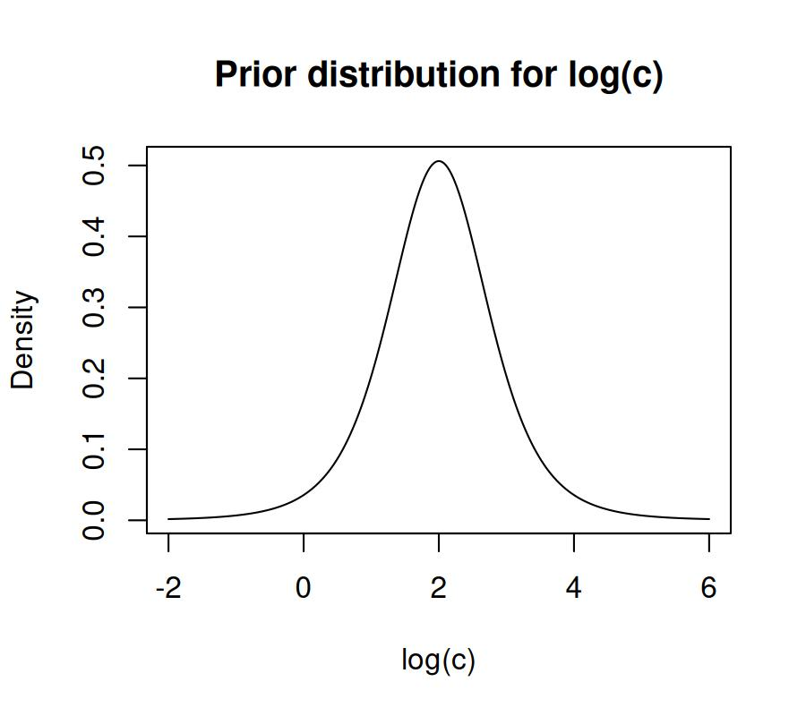
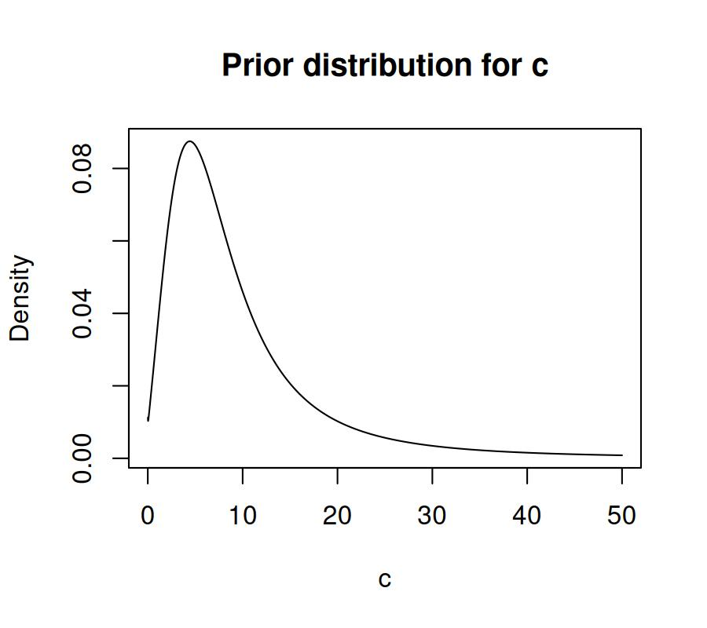

# Extracting default priors, the generated Stan code and Stan data

## 1 Default priors for models in the `bmm` package

Each model in `bmm` comes with default priors on all of its parameters.
Unlike in the `brms` package, the default priors in `bmm` are
informative, based on current expert knowledge in the domain of the
model. These default priors help with model identifiability and improve
estimation. However, because the priors are informed, it is even more
important for you to understand what priors are used when you estimate a
model, or when you report the results of a model fit.

You can use the function
[`default_prior()`](https://venpopov.com/bmm/dev/reference/default_prior.bmmformula.md)
from the `brms` package to extract the default priors for a model. The
arguments to `default_prior` are the same as for the
[`bmm()`](https://venpopov.com/bmm/dev/reference/bmm.md) function in
`bmm`. For example, if you want to extract the default priors for the
SDM model ([see the online article for more
information](https://venpopov.com/bmm/articles/bmm_sdm_simple.html)),
where you have a set_size categorical predictor of `c` and `kappa`, you
can use the following code:

``` r

library(bmm)

default_prior(bmf(c ~ 0 + set_size, kappa ~ 0 + set_size), 
              data = oberauer_lin_2017,
              model = sdm(resp_error = 'dev_rad'))
#>                     prior     class      coef group resp  dpar nlpar   lb   ub tag       source
#>     student_t(5, 2, 0.75)         b set_size1                c       <NA> <NA>     (vectorized)
#>     student_t(5, 2, 0.75)         b set_size2                c       <NA> <NA>     (vectorized)
#>     student_t(5, 2, 0.75)         b set_size3                c       <NA> <NA>     (vectorized)
#>     student_t(5, 2, 0.75)         b set_size4                c       <NA> <NA>     (vectorized)
#>     student_t(5, 2, 0.75)         b set_size5                c       <NA> <NA>     (vectorized)
#>     student_t(5, 2, 0.75)         b set_size6                c       <NA> <NA>     (vectorized)
#>     student_t(5, 2, 0.75)         b set_size7                c       <NA> <NA>     (vectorized)
#>     student_t(5, 2, 0.75)         b set_size8                c       <NA> <NA>     (vectorized)
#>  student_t(5, 1.75, 0.75)         b set_size1            kappa       <NA> <NA>     (vectorized)
#>  student_t(5, 1.75, 0.75)         b set_size2            kappa       <NA> <NA>     (vectorized)
#>  student_t(5, 1.75, 0.75)         b set_size3            kappa       <NA> <NA>     (vectorized)
#>  student_t(5, 1.75, 0.75)         b set_size4            kappa       <NA> <NA>     (vectorized)
#>  student_t(5, 1.75, 0.75)         b set_size5            kappa       <NA> <NA>     (vectorized)
#>  student_t(5, 1.75, 0.75)         b set_size6            kappa       <NA> <NA>     (vectorized)
#>  student_t(5, 1.75, 0.75)         b set_size7            kappa       <NA> <NA>     (vectorized)
#>  student_t(5, 1.75, 0.75)         b set_size8            kappa       <NA> <NA>     (vectorized)
#>     student_t(5, 2, 0.75)         b                          c       <NA> <NA>             user
#>  student_t(5, 1.75, 0.75)         b                      kappa       <NA> <NA>             user
#>               constant(0) Intercept                                  <NA> <NA>             user
```

In this case we used a formula of the type `~ 0 + factor`, which means
that the intercept is suppressed, and a separate parameter is estimated
for each level of the set_size factor variable. For the SDM model, both
`kappa` and `c` have to be positive, so they are defined in the model on
the log scale, and exponentiated afterwards. Thus, the parameters are
sampled on the log scale, and the priors are defined on the log scale as
well. The default prior for `c` is a student-t distribution with 5
degrees of freedom, a mean of 2, and a standard deviation of 0.75. This
corresponds to the following prior distribution over the log scale, with
80% of the prior mass between 0.9 and 3.10:

``` r

log_c <- seq(-2,6, 0.01)
y <- brms::dstudent_t(log_c, df = 5, mu = 2, sigma = 0.75)
plot(log_c, y, type = 'l', xlab = 'log(c)', ylab = 'Density', 
     main = 'Prior distribution for log(c)')
```



This corresponds to the following log-T prior over the native scale of
`c`, with a median of ~7.4, and 80% of the prior mass between 2.44 and
22.35:

``` r

c <- seq(0, 50, 0.01)
y <- brms::dstudent_t(log(c), df = 5, mu = 2, sigma = 0.75) / c
plot(c, y, type = 'l', xlab = 'c', ylab = 'Density', 
     main = 'Prior distribution for c')
```



The default prior for `kappa` is similar, with a lower mean, a student-t
distribution with 5 degrees of freedom, a mean of 1.75, and a standard
deviation of 0.75, which corresponds to a median of 3.5 on the native
scale.

If we had retained the intercept in the formula, the default prior above
would be placed on the intercept, while the effects of each factor level
relative to the intercept would have a default prior of normal(0, 1):

``` r

default_prior(bmf(c ~ 1 + set_size, kappa ~ 1 + set_size), 
              data = oberauer_lin_2017,
              model = sdm(resp_error = 'dev_rad'))
#>                     prior     class      coef group resp  dpar nlpar   lb   ub tag       source
#>              normal(0, 1)         b set_size2                c       <NA> <NA>     (vectorized)
#>              normal(0, 1)         b set_size3                c       <NA> <NA>     (vectorized)
#>              normal(0, 1)         b set_size4                c       <NA> <NA>     (vectorized)
#>              normal(0, 1)         b set_size5                c       <NA> <NA>     (vectorized)
#>              normal(0, 1)         b set_size6                c       <NA> <NA>     (vectorized)
#>              normal(0, 1)         b set_size7                c       <NA> <NA>     (vectorized)
#>              normal(0, 1)         b set_size8                c       <NA> <NA>     (vectorized)
#>              normal(0, 1)         b set_size2            kappa       <NA> <NA>     (vectorized)
#>              normal(0, 1)         b set_size3            kappa       <NA> <NA>     (vectorized)
#>              normal(0, 1)         b set_size4            kappa       <NA> <NA>     (vectorized)
#>              normal(0, 1)         b set_size5            kappa       <NA> <NA>     (vectorized)
#>              normal(0, 1)         b set_size6            kappa       <NA> <NA>     (vectorized)
#>              normal(0, 1)         b set_size7            kappa       <NA> <NA>     (vectorized)
#>              normal(0, 1)         b set_size8            kappa       <NA> <NA>     (vectorized)
#>              normal(0, 1)         b                          c       <NA> <NA>             user
#>     student_t(5, 2, 0.75) Intercept                          c       <NA> <NA>             user
#>              normal(0, 1)         b                      kappa       <NA> <NA>             user
#>  student_t(5, 1.75, 0.75) Intercept                      kappa       <NA> <NA>             user
#>               constant(0) Intercept                                  <NA> <NA>             user
```

You can also see that in both cases, the last line is “constant(0)” on
the Intercept of the `mu` parameter, which is fixed to 0 by default in
the model, and is not estimated. You might wonder why it doesn’t say
`mu` in the `dpar` column of that prior - this is because `brms` assumes
`mu` is the default parameter in all models, so it hides it in the
output. If you wanted to estimate `mu`, instead of leaving it fixed, the
prior for it would change as well:

``` r

default_prior(bmf(mu ~ 1 + set_size, c ~ 1, kappa ~ 1),
              data = oberauer_lin_2017,
              model = sdm(resp_error = 'dev_rad'))
#>                     prior     class      coef group resp  dpar nlpar   lb   ub tag       source
#>           normal(0, 0.25)         b set_size2                        <NA> <NA>     (vectorized)
#>           normal(0, 0.25)         b set_size3                        <NA> <NA>     (vectorized)
#>           normal(0, 0.25)         b set_size4                        <NA> <NA>     (vectorized)
#>           normal(0, 0.25)         b set_size5                        <NA> <NA>     (vectorized)
#>           normal(0, 0.25)         b set_size6                        <NA> <NA>     (vectorized)
#>           normal(0, 0.25)         b set_size7                        <NA> <NA>     (vectorized)
#>           normal(0, 0.25)         b set_size8                        <NA> <NA>     (vectorized)
#>           normal(0, 0.25)         b                                  <NA> <NA>             user
#>            normal(0, 0.5) Intercept                                  <NA> <NA>             user
#>     student_t(5, 2, 0.75) Intercept                          c       <NA> <NA>             user
#>  student_t(5, 1.75, 0.75) Intercept                      kappa       <NA> <NA>             user
```

The `mu` parameter uses a `tan_half` link function, so its priors live
on the scale of `tan(mu / 2)`. The `normal(0, 0.5)` intercept prior
places 95% of the prior mass within 89 degrees of the target and
regularizes the bias toward zero, and the `normal(0, 0.25)` prior on the
regression coefficients corresponds to a difference between two
conditions with a standard deviation of 24 degrees on the native scale.

Random effects get default priors too. `brms` puts a
`student_t(3, 0, 2.5)` prior on every random-effects standard deviation,
which on a log scale lets individual parameters vary by a factor of
`exp(2.5) = 12` around the group value. `bmm` instead sets an
exponential prior on the standard deviation of each parameter, with a
rate chosen for the parameter’s link scale:

``` r

default_prior(bmf(c ~ 1 + set_size + (1 + set_size | ID), kappa ~ 1 + (1 | ID)),
              data = oberauer_lin_2017,
              model = sdm(resp_error = 'dev_rad'))
#>                     prior     class      coef group resp  dpar nlpar   lb   ub tag       source
#>                    lkj(2)       cor              ID                  <NA> <NA>     (vectorized)
#>              normal(0, 1)         b set_size2                c       <NA> <NA>     (vectorized)
#>              normal(0, 1)         b set_size3                c       <NA> <NA>     (vectorized)
#>              normal(0, 1)         b set_size4                c       <NA> <NA>     (vectorized)
#>              normal(0, 1)         b set_size5                c       <NA> <NA>     (vectorized)
#>              normal(0, 1)         b set_size6                c       <NA> <NA>     (vectorized)
#>              normal(0, 1)         b set_size7                c       <NA> <NA>     (vectorized)
#>              normal(0, 1)         b set_size8                c       <NA> <NA>     (vectorized)
#>            exponential(1)        sd              ID          c       <NA> <NA>     (vectorized)
#>            exponential(1)        sd Intercept    ID          c       <NA> <NA>     (vectorized)
#>            exponential(1)        sd set_size2    ID          c       <NA> <NA>     (vectorized)
#>            exponential(1)        sd set_size3    ID          c       <NA> <NA>     (vectorized)
#>            exponential(1)        sd set_size4    ID          c       <NA> <NA>     (vectorized)
#>            exponential(1)        sd set_size5    ID          c       <NA> <NA>     (vectorized)
#>            exponential(1)        sd set_size6    ID          c       <NA> <NA>     (vectorized)
#>            exponential(1)        sd set_size7    ID          c       <NA> <NA>     (vectorized)
#>            exponential(1)        sd set_size8    ID          c       <NA> <NA>     (vectorized)
#>            exponential(1)        sd              ID      kappa       <NA> <NA>     (vectorized)
#>            exponential(1)        sd Intercept    ID      kappa       <NA> <NA>     (vectorized)
#>            exponential(1)        sd                          c       <NA> <NA>             user
#>              normal(0, 1)         b                          c       <NA> <NA>             user
#>     student_t(5, 2, 0.75) Intercept                          c       <NA> <NA>             user
#>            exponential(1)        sd                      kappa       <NA> <NA>             user
#>  student_t(5, 1.75, 0.75) Intercept                      kappa       <NA> <NA>             user
#>                    lkj(2)       cor                                  <NA> <NA>             user
#>               constant(0) Intercept                                  <NA> <NA>             user
```

The `exponential(1)` prior on the standard deviation of `c` and `kappa`
has a median of 0.69 on the log scale, so a typical participant lies
within a factor of 2 of the group value, while its 95% quantile of 3
still admits large individual differences. The prior applies to all
standard deviations of a parameter, for random intercepts and random
slopes alike and for every grouping factor. To override it, address the
standard deviation of the parameter with `dpar` (for example `mu`, `c`
and `kappa` in the SDM) or `nlpar` (for example `kappa` and `thetat` in
the mixture models), as in
`set_prior("exponential(2)", class = "sd", dpar = "kappa")`.

The correlations among random effects belong to a grouping factor rather
than to a single parameter. Accordingly, they get one default prior for
the whole model: `lkj(2)`, the `cor` row in the output above, instead of
the uniform `lkj(1)` of `brms`. For two correlated effects, `lkj(1)`
places 10% of its mass on correlations beyond ±.9, whereas `lkj(2)`
places 1.45% there and 95% within ±.81. The prior thus discounts
near-perfect correlations without ruling out strong ones. `bmm` sets it
only when the model estimates a correlation matrix, that is, not for
`(1 | ID)` or `(1 + set_size || ID)`. To return to the `brms` default,
use `set_prior("lkj(1)", class = "cor")`.

All of the above examples make an important point - priors are always
specified on the scale at which the parameters are sampled. You can
always check the documentation for a given model to see the links for
the parameters (e.g.
[`?sdm`](https://venpopov.com/bmm/dev/reference/sdm.md)).

To overwrite the default priors and set your own, you can use the
`set_prior` function from `brms`. For more information, see
[`?brms::set_prior`](https://paulbuerkner.com/brms/reference/set_prior.html).

## 2 Extracting the Stan code

The Stan code used for fitting a model is generated together by `bmm`
and `brms`. `bmm` takes care of the code specific to the model, while
`brms` generates the code for the regression syntax, priors and
everything else. If you want to get the Stan code that would be used for
fitting a model, so that you can inspect it or modify it, you can use
the
[`stancode()`](https://venpopov.com/bmm/dev/reference/stancode.bmmformula.md)
function from `brms`:

``` r

stancode(bmf(c ~ 0 + set_size, kappa ~ 0 + set_size), 
         data = oberauer_lin_2017,
         model = sdm(resp_error = 'dev_rad'))
```

    // generated with brms 2.23.0 and bmm 1.4.1.9000
    functions {
      /* compute the tan_half link
       * Args:
       *   x: a scalar in (-pi, pi)
       * Returns:
       *   a scalar in (-Inf, Inf)
       */
       real tan_half(real x) {
         return tan(x / 2);
       }
      /* compute the tan_half link (vectorized)
       * Args:
       *   x: a vector in (-pi, pi)
       * Returns:
       *   a vector in (-Inf, Inf)
       */
       vector tan_half(vector x) {
         return tan(x / 2);
       }
      /* compute the inverse of the tan_half link
       * Args:
       *   y: a scalar in (-Inf, Inf)
       * Returns:
       *   a scalar in (-pi, pi)
       */
       real inv_tan_half(real y) {
         return 2 * atan(y);
       }
      /* compute the inverse of the tan_half link (vectorized)
       * Args:
       *   y: a vector in (-Inf, Inf)
       * Returns:
       *   a vector in (-pi, pi)
       */
       vector inv_tan_half(vector y) {
         return 2 * atan(y);
       }


      // log of the numerator of the sdm likelihood
      real sdm_simple_lpdf(vector y, vector mu, vector c, vector kappa) {
        int N = size(y);
        vector[N] num = exp(fma(kappa,cos(y-mu)-1,c)) ;
        real out = dot_product(num, sqrt(kappa));
        out *= inv(sqrt2()) * inv_sqrt(pi());
        return(out);
      }

      // Minus the log of the mean of exp(eta(u)) over the circle, where
      // eta(u) = exp(c) sqrt(kappa / (2 pi)) exp(kappa (cos(u) - 1)) and c is on the
      // log scale. eta is even, so [0, pi] carries the whole integral. The spike at
      // u = 0 narrows with kappa and its peak grows with c (#615). Its squared
      // inverse width is about peak * kappa at the top, at most 2 kappa log(peak)
      // where it meets the floor, and kappa for a small peak, so kappa (peak + 1)
      // measures how sharp it is. Up to 4000, which takes in exp(c) <= 50 with
      // kappa <= 30, a fixed rule with nodes crowded toward u = 0 resolves it;
      // wide_cosm1 holds cos(u) - 1 at its nodes. Sharper spikes get Gauss-Legendre
      // on panels cut at multiples of two widths: w, where eta falls to about 1,
      // and s, the SD of exp(eta) near the peak, which is far narrower than w once
      // the peak is large. The last w cut is at 5 w because past 3 w the spike of a
      // small peak still carries up to 1.2e-6 of the integral above its floor,
      // and 1.2e-13 past 5 w. eta - peak is formed as
      // peak expm1(kappa (cos(u) - 1)), with cos(u) - 1 free of cancellation,
      // because cos(u) - 1 and eta - peak both cancel near the peak.
      real sdm_simple_ldenom(real c, real kappa, data vector gl_x, data vector gl_w,
                             data vector wide_cosm1, data vector wide_w) {
        int n_nodes = num_elements(gl_x);
        real log_peak = c + 0.5 * log(kappa / (2 * pi()));
        real peak = exp(log_peak);
        if (kappa * (peak + 1) <= 4000) {
          return log(pi()) - peak - log(dot_product(wide_w, exp(peak * expm1(kappa * wide_cosm1))));
        }
        real w = fmin(pi(), sqrt(2 * fmax(log_peak, 1) / kappa));
        real s = exp(-0.5 * (log_peak + log(kappa)));
        vector[9] cuts = [0, pi(), 0.5 * w, w, 2 * w, 5 * w, s, 3 * s, 9 * s]';
        real log_int = negative_infinity();
        for (i in 1:9) {
          cuts[i] = fmin(fmax(cuts[i], 0), pi());
        }
        cuts = sort_asc(cuts);
        for (i in 1:8) {
          if (cuts[i + 1] > cuts[i]) {
            real half = (cuts[i + 1] - cuts[i]) / 2;
            vector[n_nodes] u = (cuts[i] + cuts[i + 1]) / 2 + half * gl_x;
            vector[n_nodes] d = peak * expm1(-2 * kappa * square(sin(u / 2)));
            real d_max = max(d);
            log_int = log_sum_exp(log_int, log(half) + d_max + log(dot_product(gl_w, exp(d - d_max))));
          }
        }
        return log(pi()) - peak - log_int;
      }

      real sdm_simple_run_ldenom(vector c, vector kappa, data vector gl_x,
                                 data vector gl_w, data vector wide_cosm1,
                                 data vector wide_w, int G_runs,
                                 array[] int run_start, array[] int run_count) {
        real out = 0;
        for (g in 1:G_runs) {
          int n = run_start[g];
          out += run_count[g] * sdm_simple_ldenom(c[n], kappa[n], gl_x, gl_w, wide_cosm1, wide_w);
        }
        return(out);
      }

      real sdm_simple_run_ldenom_slice(vector c, vector kappa, data vector gl_x,
                                       data vector gl_w, data vector wide_cosm1,
                                       data vector wide_w, int start, int end,
                                       int G_runs, array[] int run_start,
                                       array[] int run_count) {
        real out = 0;
        for (g in 1:G_runs) {
          if (run_start[g] >= start && run_start[g] <= end) {
            int n = run_start[g] - start + 1;
            out += run_count[g] * sdm_simple_ldenom(c[n], kappa[n], gl_x, gl_w, wide_cosm1, wide_w);
          }
        }
        return(out);
      }
    }
    data {
      int<lower=1> N;  // total number of observations
      vector[N] Y;  // response variable
      int<lower=1> K_c;  // number of population-level effects
      matrix[N, K_c] X_c;  // population-level design matrix
      int<lower=1> K_kappa;  // number of population-level effects
      matrix[N, K_kappa] X_kappa;  // population-level design matrix
      int prior_only;  // should the likelihood be ignored?
      vector[16] sdm_gl_x;
      vector[16] sdm_gl_w;
      vector[32] sdm_wide_cosm1;
      vector[32] sdm_wide_w;
      int G_sdm_runs;
      array[G_sdm_runs] int sdm_run_start;
      array[G_sdm_runs] int sdm_run_count;
    }
    transformed data {
        // fail fast if the run metadata computed in R does not match the data Stan received
      {
        int sdm_run_total = 0;
        for (g in 1:G_sdm_runs) {
          if (sdm_run_start[g] < 1 || sdm_run_start[g] > N) {
            reject("bmm error: sdm_run_start[", g, "] = ", sdm_run_start[g],
                   " is outside the data range [1, ", N, "]. The SDM run metadata ",
                   "does not match the model data. Please report this at ",
                   "https://github.com/popov-lab/bmm/issues");
          }
          if (g > 1 && sdm_run_start[g] <= sdm_run_start[g - 1]) {
            reject("bmm error: sdm_run_start must be strictly increasing. The SDM ",
                   "run metadata does not match the model data. Please report ",
                   "this at https://github.com/popov-lab/bmm/issues");
          }
          sdm_run_total += sdm_run_count[g];
        }
        if (sdm_run_total != N) {
          reject("bmm error: sum(sdm_run_count) = ", sdm_run_total, " but N = ", N,
                 ". The SDM run metadata does not match the model data. Please ",
                 "report this at https://github.com/popov-lab/bmm/issues");
        }
      }
    }
    parameters {
      vector[K_c] b_c;  // regression coefficients
      vector[K_kappa] b_kappa;  // regression coefficients
    }
    transformed parameters {
      real Intercept;  // temporary intercept for centered predictors
      // prior contributions to the log posterior
      real lprior = 0;
      Intercept = 0;
      lprior += student_t_lpdf(b_c | 5, 2, 0.75);
      lprior += student_t_lpdf(b_kappa | 5, 1.75, 0.75);
    }
    model {
      // likelihood including constants
      if (!prior_only) {
        // initialize linear predictor term
        vector[N] mu = rep_vector(0.0, N);
        // initialize linear predictor term
        vector[N] c = rep_vector(0.0, N);
        // initialize linear predictor term
        vector[N] kappa = rep_vector(0.0, N);
        mu += Intercept;
        c += X_c * b_c;
        kappa += X_kappa * b_kappa;
        mu = inv_tan_half(mu);
        kappa = exp(kappa);
        target += sdm_simple_lpdf(Y | mu, c, kappa);
          target += sdm_simple_run_ldenom(c, kappa, sdm_gl_x, sdm_gl_w, sdm_wide_cosm1,
                                        sdm_wide_w, G_sdm_runs, sdm_run_start,
                                        sdm_run_count);
        target += -(log2()+log(pi()))*N;
      }
      // priors including constants
      target += lprior;
    }
    generated quantities {
      // actual population-level intercept
      real b_Intercept = Intercept;
    }

Alternatively, if you already have a fitted model object, you can just
call
[`stancode()`](https://venpopov.com/bmm/dev/reference/stancode.bmmformula.md)
on that object, which will give you the same result:

``` r

fit <- bmm(bmf(c ~ 0 + set_size, kappa ~ 0 + set_size), 
              data = oberauer_lin_2017,
              model = sdm(resp_error = 'dev_rad'))
stancode(fit)
```

## 3 Extracting the Stan data

If you want to extract the data that would be used for fitting a model,
you can use the
[`standata()`](https://venpopov.com/bmm/dev/reference/standata.bmmformula.md)
function from `brms`. This function will return a list with the data
that would be passed to Stan for fitting the model.

``` r

sd <- standata(bmf(c ~ 0 + set_size, kappa ~ 0 + set_size), 
               data = oberauer_lin_2017,
               model = sdm(resp_error = 'dev_rad'))
str(sd)
#> List of 17
#>  $ N             : int 15200
#>  $ Y             : num [1:15200(1d)] 0.384 -0.4538 -0.0873 0.3665 -0.0349 ...
#>  $ K             : int 1
#>  $ Kc            : num 0
#>  $ X             : num [1:15200, 1] 1 1 1 1 1 1 1 1 1 1 ...
#>   ..- attr(*, "dimnames")=List of 2
#>   .. ..$ : chr [1:15200] "1" "2" "3" "4" ...
#>   .. ..$ : chr "Intercept"
#>   ..- attr(*, "assign")= int 0
#>  $ K_c           : int 8
#>  $ X_c           : num [1:15200, 1:8] 0 0 0 0 1 1 0 0 0 0 ...
#>   ..- attr(*, "dimnames")=List of 2
#>   .. ..$ : chr [1:15200] "1" "2" "3" "4" ...
#>   .. ..$ : chr [1:8] "set_size1" "set_size2" "set_size3" "set_size4" ...
#>   ..- attr(*, "assign")= int [1:8] 1 1 1 1 1 1 1 1
#>   ..- attr(*, "contrasts")=List of 1
#>   .. ..$ set_size: num [1:8, 1:7] 0 1 0 0 0 0 0 0 0 0 ...
#>   .. .. ..- attr(*, "dimnames")=List of 2
#>   .. .. .. ..$ : chr [1:8] "1" "2" "3" "4" ...
#>   .. .. .. ..$ : chr [1:7] "2" "3" "4" "5" ...
#>  $ K_kappa       : int 8
#>  $ X_kappa       : num [1:15200, 1:8] 0 0 0 0 1 1 0 0 0 0 ...
#>   ..- attr(*, "dimnames")=List of 2
#>   .. ..$ : chr [1:15200] "1" "2" "3" "4" ...
#>   .. ..$ : chr [1:8] "set_size1" "set_size2" "set_size3" "set_size4" ...
#>   ..- attr(*, "assign")= int [1:8] 1 1 1 1 1 1 1 1
#>   ..- attr(*, "contrasts")=List of 1
#>   .. ..$ set_size: num [1:8, 1:7] 0 1 0 0 0 0 0 0 0 0 ...
#>   .. .. ..- attr(*, "dimnames")=List of 2
#>   .. .. .. ..$ : chr [1:8] "1" "2" "3" "4" ...
#>   .. .. .. ..$ : chr [1:7] "2" "3" "4" "5" ...
#>  $ prior_only    : int 0
#>  $ sdm_gl_x      : num [1:16] -0.989 -0.945 -0.866 -0.755 -0.618 ...
#>  $ sdm_gl_w      : num [1:16] 0.0272 0.0623 0.0952 0.1246 0.1496 ...
#>  $ sdm_wide_cosm1: num [1:32] -0.00001 -0.000091 -0.000258 -0.00052 -0.000894 ...
#>  $ sdm_wide_w    : num [1:32] 0.00896 0.00909 0.00936 0.00976 0.01031 ...
#>  $ G_sdm_runs    : int 13397
#>  $ sdm_run_start : int [1:13397(1d)] 1 2 3 4 5 7 8 9 10 11 ...
#>  $ sdm_run_count : int [1:13397(1d)] 1 1 1 1 2 1 1 1 1 1 ...
#>  - attr(*, "class")= chr [1:2] "standata" "list"
```
