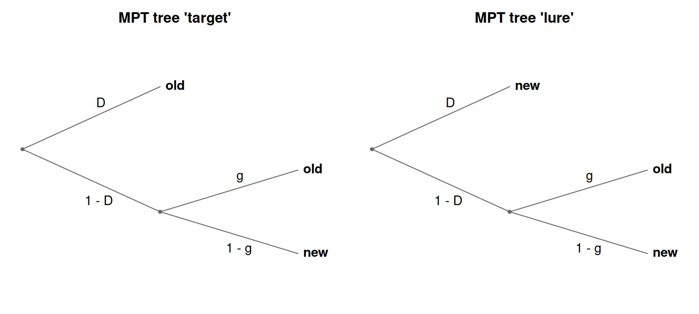
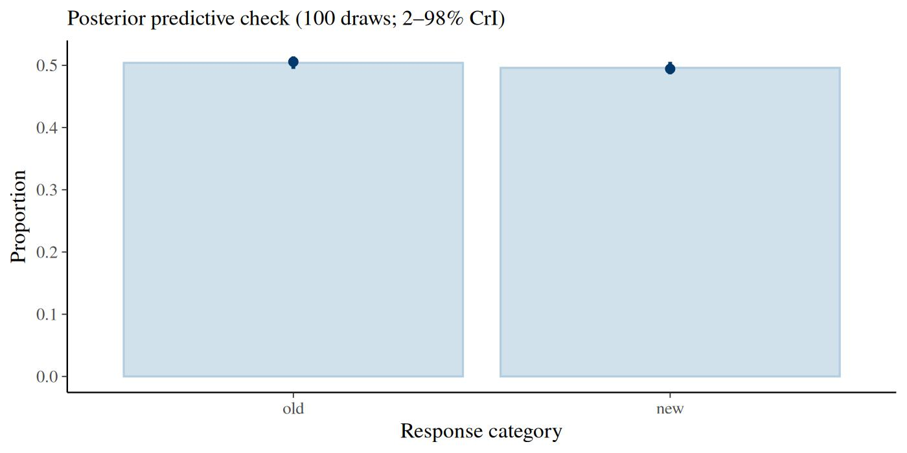
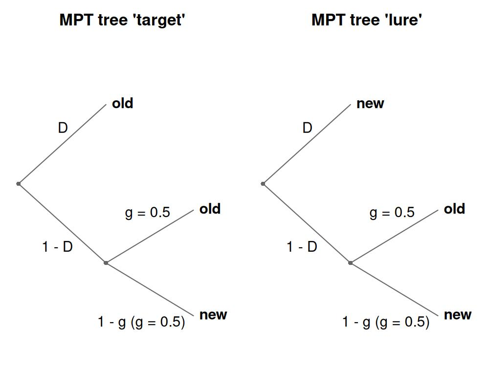
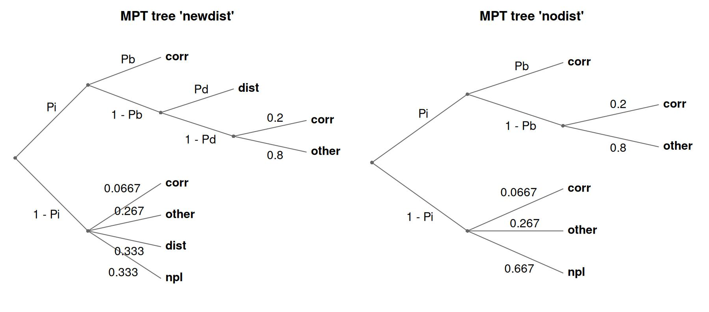
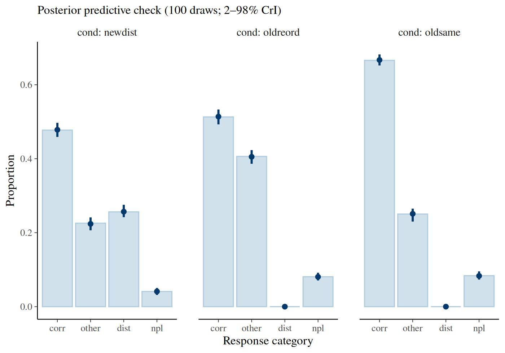

# Multinomial Processing Tree (MPT) models

## 1 Introduction to the model

Multinomial Processing Tree (MPT) models are a family of measurement
models for tasks with categorical responses (Riefer and Batchelder 1988;
Batchelder and Riefer 1999; Erdfelder et al. 2009). They assume that
each observed response results from a sequence of discrete latent
processing states, for example detecting an item in memory and, if
detection fails, guessing. Each latent process succeeds with some
probability, and the branches of the resulting processing tree map every
combination of latent outcomes onto one observable response category.
The probability of a response category is the sum of the probabilities
of all branches that terminate in it, and each branch probability is the
product of the process probabilities along its path.

The classic example is the two-high-threshold model (2HTM) of
recognition memory. In an old/new recognition test, participants see two
kinds of probe, targets (items studied before) and lures (new items),
and respond “old” or “new” to each. The 2HTM assumes different processes
for the two kinds of probe. A target is detected as old with probability
\\D\\; if detection fails (probability \\1 - D\\), the participant
guesses “old” with probability \\g\\. A lure is detected as new with
probability \\D\\ (the two detection probabilities can also be
separated), and otherwise guessed on in the same way. The model
therefore has one tree per probe type, not one per response: the target
tree and the lure tree each end in both responses, “old” and “new”.



Each panel is one tree, titled with the probe type it describes. Its
leaves are the response categories, “old” and “new”, which both trees
share. A response category collects the probability of every leaf that
ends in it, which gives:

\\ \begin{aligned} P(\text{"old"} \mid \text{target}) &= D + (1 - D)
\cdot g \\ P(\text{"new"} \mid \text{target}) &= (1 - D) \cdot (1 - g)
\\ P(\text{"old"} \mid \text{lure}) &= (1 - D) \cdot g \\ P(\text{"new"}
\mid \text{lure}) &= D + (1 - D) \cdot (1 - g) \end{aligned} \\

In `bmm`, MPT models are fit as hierarchical Bayesian models: all latent
probability parameters are estimated on an unconstrained latent scale
(logit by default, or probit), where they can be predicted by fixed and
random effects using the standard `bmmformula` syntax. With a probit
link and correlated random effects across all parameters, this is the
latent-trait approach of Klauer (2010) as implemented, for example, in
TreeBUGS (Heck et al. 2018).

The article follows the order of a typical analysis: specifying the
trees, preparing and simulating data, fitting, interpreting the
estimates, constraining parameters, and two extensions (covariates
inside branch expressions, non-linear parameter formulas), followed by a
real-data example. If you already have a model file for multiTree,
MPTinR or TreeBUGS, jump to [Importing existing model
definitions](#importing-existing-model-definitions); if you are coming
from MPTinR or TreeBUGS, read [Specifying an MPT
model](#specifying-an-mpt-model) first and then [Migrating from MPTinR
or TreeBUGS](#migrating-from-mptinr-or-treebugs), which maps the
functions of those packages onto `bmm`.

## 2 Specifying an MPT model

An MPT model is specified as a set of trees. Each tree is created with
[`mpt_tree()`](https://venpopov.com/bmm/dev/reference/mpt_tree.md): it
has a name, and one branch-probability expression per response category,
written as a formula `category ~ expression`:

``` r

library(bmm)

tree_target <- mpt_tree("target",
  old ~ D + (1 - D) * g,
  new ~ (1 - D) * (1 - g)
)
tree_lure <- mpt_tree("lure",
  old ~ (1 - D) * g,
  new ~ D + (1 - D) * (1 - g)
)
tree_target
#> MPT tree 'target':
#>   P(old) = D + (1 - D) * g
#>   P(new) = (1 - D) * (1 - g)
```

The first argument names the probe type the tree describes; the
left-hand sides are the response categories, and every tree lists the
same ones. The formulas only carry the expressions and the response
category on the left-hand side; nothing in them is evaluated. The
expressions can equally be given as a named list of character strings,
which is the form that
[`mpt_from_string()`](https://venpopov.com/bmm/dev/reference/mpt_from_string.md)
and
[`mpt_from_eqn()`](https://venpopov.com/bmm/dev/reference/mpt_from_eqn.md)
produce. The two spellings give identical trees:

``` r

tree_target_strings <- mpt_tree("target", list(
  old = "D + (1 - D) * g",
  new = "(1 - D) * (1 - g)"
))
identical(tree_target, tree_target_strings)
#> [1] TRUE
```

The trees are combined into a model object with
[`mpt()`](https://venpopov.com/bmm/dev/reference/mpt.md). The `tree_id`
argument names the data column whose values say which tree each
observation belongs to; here `item_type`, holding `"target"` and
`"lure"`, which must match the tree names. The response counts go in
columns named after the response categories, `old` and `new` (see [Data
format and simulation](#data-format-and-simulation)). Printing the model
lists the trees and then checks identifiability in two ways: it compares
the number of free parameters with the degrees of freedom the trees
provide (response categories minus 1, summed over trees), the classical
bound that MPTinR’s `check.mpt()` reports, and it computes the rank of
the Jacobian of the category probabilities at interior parameter values:

``` r

model_2htm <- mpt(
  trees = list(tree_target, tree_lure),
  tree_id = "item_type"
)
model_2htm
```

``` fansi
#> mpt(trees = list(tree_target, tree_lure),     tree_id = "item_type") 
#> Response:   resp_cats = old, new (counts per response category) 
#> Parameters: D, g 
#> Links:      D = logit; g = logit 
#> MPT tree 'target':
#>   P(old) = D + (1 - D) * g
#>   P(new) = (1 - D) * (1 - g)
#> MPT tree 'lure':
#>   P(old) = (1 - D) * g
#>   P(new) = D + (1 - D) * (1 - g)
#> Identifiability (intercept-only formulas): 2 free parameter(s), 2 degrees of freedom (response categories minus 1, summed over trees) 
#>   Jacobian rank 2 of 2 at interior test values: locally identified.
#> Use parameter_info() for parameter descriptions, links and fixed values.
```

The two checks answer different questions. The classical bound counts
parameters against the information the response categories carry; the
rank asks whether the branch expressions actually separate the
parameters they contain, which can fail even when the counting works
out. *Locally identified* means the rank is full at the test values, so
no direction in parameter space leaves every category probability
unchanged there. Both checks assume intercept-only formulas, which is
why the printed line says so.
[`bmm()`](https://venpopov.com/bmm/dev/reference/bmm.md) follows two
rules: it warns when the rank is deficient and every formula is
intercept-only, and it only says that predictors or non-linear formulas
may identify the parameters, without checking, when any formula has a
predictor or is non-linear. It looks at the data only for covariates: it
takes the rank again at the covariate values each tree has in the data
and reports a rank below the printed one in the same way, which catches
a covariate with a single value per tree.
[`parameter_info()`](https://venpopov.com/bmm/dev/reference/parameter_info.md)
lists the parameters with their links and any fixed values.

`tree_id` is about *structure*, not about experimental manipulations. A
separate tree is needed only when the branch expressions themselves
differ, that is, when the trial determines which latent processes apply
or which response categories are reachable at all. Effects of
experimental factors on the parameters go in the parameter formulas,
exactly as in every other `bmm` model. The two roles are independent,
and the same column can serve both when a factor happens to change the
structure as well.

The [`plot()`](https://rdrr.io/r/graphics/plot.default.html) method
draws the processing trees implied by the branch expressions: each
product in an expression is one root-to-leaf path, and paths sharing a
common prefix share the corresponding nodes. This is a quick way to
verify that the expressions encode the intended tree; the figure in the
[Introduction to the model](#introduction-to-the-model) was drawn with
this call:

``` r

plot(model_2htm)
```

The latent parameters are identified automatically from the branch
expressions: every symbol that is not a declared covariate (see
[Design-fixed covariates in branch
expressions](#design-fixed-covariates-in-branch-expressions)) is treated
as a parameter. Equality constraints follow directly from the naming.
Because both trees use the same symbol `D`, detection is equated for
targets and lures. To estimate separate detection probabilities, write
`Do` and `Dn` instead:

``` r

tree_target_sep <- mpt_tree("target", list(
  old = "Do + (1 - Do) * g",
  new = "(1 - Do) * (1 - g)"
))
tree_lure_sep <- mpt_tree("lure", list(
  old = "(1 - Dn) * g",
  new = "Dn + (1 - Dn) * (1 - g)"
))
model_2htm_sep <- mpt(
  trees = list(tree_target_sep, tree_lure_sep),
  tree_id = "item_type"
)
model_2htm_sep
```

``` fansi
#> mpt(trees = list(tree_target_sep, tree_lure_sep),     tree_id = "item_type") 
#> Response:   resp_cats = old, new (counts per response category) 
#> Parameters: Do, g, Dn 
#> Links:      Do = logit; g = logit; Dn = logit 
#> MPT tree 'target':
#>   P(old) = Do + (1 - Do) * g
#>   P(new) = (1 - Do) * (1 - g)
#> MPT tree 'lure':
#>   P(old) = (1 - Dn) * g
#>   P(new) = Dn + (1 - Dn) * (1 - g)
#> Identifiability (intercept-only formulas): 3 free parameter(s), 2 degrees of freedom (response categories minus 1, summed over trees) 
#>   More free parameters than degrees of freedom: the model is not identified without further constraints.
#>   Jacobian rank 2 of 3 at interior test values: the combination of all
#>     free parameters is not identified by the branch expressions.
#> Use parameter_info() for parameter descriptions, links and fixed values.
```

The printed note is the well-known result that a 2HTM with separate
detection parameters is not identified from a single old/new test: three
free parameters, two degrees of freedom, and a Jacobian of rank 2, so
one combination of the three cannot be estimated. The model becomes
identifiable with a second condition that varies the response bias
(different base rates or payoffs), which adds two degrees of freedom and
one parameter, or with a restriction (see [Constraining
parameters](#constraining-parameters)). The order constraint \\D_o \>
D_n\\ shown there is a different kind of remedy: it keeps the two
detection parameters ordered in every posterior draw, but it does not
add information, so the rank deficit remains and \\D_n\\ stays weakly
determined.

Two things to keep in mind when writing branch expressions:

- Parameter and category names must consist of letters and digits only
  (no underscores or dots), because they become non-linear parameters in
  **brms**.
- Numeric fractions such as `1/4` are converted to decimal literals
  (`0.25`) when the tree is created. In Stan, a bare integer fraction
  would be evaluated as integer division.

The default link is the logit. `links = "probit"` selects the probit
link that latent-trait MPT models traditionally use for every parameter,
and switches the default priors accordingly (see [Default
priors](#default-priors)); a named list, `links = list(D = "probit")`,
switches single parameters and their priors:

``` r

model_2htm_probit <- mpt(
  trees = list(tree_target, tree_lure),
  tree_id = "item_type",
  links = "probit"
)
```

## 3 Data format and simulation

The data contain one column of aggregated response counts per response
category, named after the branch names of the trees, plus the `tree_id`
column. Aggregated counts are sufficient whenever parameters and
covariates are constant within participant and condition. Trial-level
data (one row per trial with a 1 in the chosen category’s column) also
work and are only needed when predictors vary from trial to trial.

The distribution functions
[`dmpt()`](https://venpopov.com/bmm/dev/reference/mptdist.md) and
[`rmpt()`](https://venpopov.com/bmm/dev/reference/mptdist.md) provide
the multinomial density and random generation for any
[`mpt()`](https://venpopov.com/bmm/dev/reference/mpt.md) model.
[`rmpt()`](https://venpopov.com/bmm/dev/reference/mptdist.md) draws the
counts for one tree and one parameter vector; a short function around it
simulates a hierarchical data set in the shape of TreeBUGS’
`genTraitMPT()`: population means on the probability scale, participant
heterogeneity as standard deviations on the latent scale (here the logit
scale; the `sigma` of `genTraitMPT()` is on the probit scale, see
[Default priors](#default-priors) for the conversion).

``` r

simulate_2htm <- function(n_subj, n_items, mean, sd) {
  latent <- data.frame(
    D = rnorm(n_subj, qlogis(mean[["D"]]), sd[["D"]]),
    g = rnorm(n_subj, qlogis(mean[["g"]]), sd[["g"]])
  )
  dat <- expand.grid(
    id = factor(seq_len(n_subj)),
    item_type = c("target", "lure"),
    stringsAsFactors = FALSE
  )
  counts <- t(sapply(seq_len(nrow(dat)), function(i) {
    subj <- as.integer(dat$id[i])
    rmpt(
      n = 1, size = n_items,
      pars = plogis(c(D = latent$D[subj], g = latent$g[subj])),
      mpt_model = model_2htm, tree = dat$item_type[i]
    )[1, ]
  }))
  cbind(dat, counts)
}

set.seed(124)
dat <- simulate_2htm(
  n_subj = 40, n_items = 100,
  mean = c(D = 0.7, g = 0.5), sd = c(D = 0.4, g = 0.3)
)
head(dat)
#>   id item_type old new
#> 1  1    target  78  22
#> 2  2    target  87  13
#> 3  3    target  77  23
#> 4  4    target  80  20
#> 5  5    target  89  11
#> 6  6    target  90  10
```

Each participant contributes two rows, one per probe type, and the
counts in the `old` and `new` columns sum to 100 within a row.

## 4 Fitting the model

Model parameters are predicted with the usual `bmmformula` syntax. Here
both parameters get a population intercept and a random intercept per
participant. Written as `(1 | id)` in each formula, the two person
effects are independent of each other, which matches the simulation
above: it draws `D` and `g` independently. A shared label, `(1 |p| id)`
in both formulas, would estimate their correlation as well, which is the
latent-trait model; [Migrating from MPTinR or
TreeBUGS](#migrating-from-mptinr-or-treebugs) discusses these options.

``` r

fit_2htm <- bmm(
  formula = bmf(
    D ~ 1 + (1 | id),
    g ~ 1 + (1 | id)
  ),
  data = dat,
  model = model_2htm,
  backend = "cmdstanr",
  cores = 4,
  refresh = 0,
  file = "fits/mpt_2htm_v2"
)
```

``` r

summary(fit_2htm)
#> Loading required namespace: rstan
```

``` fansi
#>   Model: mpt(trees = list(tree_target, tree_lure),
#>              tree_id = "item_type") 
#>   Links: D = logit; g = logit 
#> Formula: D ~ 1 + (1 | id)
#>          g ~ 1 + (1 | id) 
#>    Data: dat (Number of observations: 80)
#>   Draws: 4 chains, each with iter = 2000; warmup = 1000; thin = 1;
#>          total post-warmup draws = 4000
#> 
#> Multilevel Hyperparameters:
#> ~id (Number of levels: 40) 
#>                 Estimate Est.Error l-95% CI u-95% CI Rhat Bulk_ESS Tail_ESS
#> sd(D_Intercept)     0.35      0.06     0.24     0.48 1.00     1568     2067
#> sd(g_Intercept)     0.19      0.10     0.02     0.38 1.01      755     1342
#> 
#> Regression Coefficients:
#>             Estimate Est.Error l-95% CI u-95% CI Rhat Bulk_ESS Tail_ESS
#> D_Intercept     0.77      0.07     0.64     0.90 1.00     1769     2560
#> g_Intercept     0.05      0.06    -0.07     0.17 1.00     3655     2477
#> 
#> Draws were sampled using sample(hmc). For each parameter, Bulk_ESS
#> and Tail_ESS are effective sample size measures, and Rhat is the potential
#> scale reduction factor on split chains (at convergence, Rhat = 1).
```

All estimates are on the logit scale; the next section converts them to
probabilities.

### 4.1 Default priors

The default priors are matched to the link function: with the logit
link, intercepts and regression effects both get a `logistic(0, 1)`
prior, which for an intercept is a uniform distribution on the
probability scale. Effects get the same width as intercepts because a
narrower prior pulls condition differences toward zero when the formula
is written as `1 + cond`. With `links = "probit"`, both get
`normal(0, 1)`, matching the priors typically used in latent-trait MPT
models. Random-effects standard deviations get `exponential(1)` with the
logit link and `exponential(2)` with the probit link, because a probit
SD is about 1/1.7 of the logit SD it corresponds to; the rate of 1.7
this implies is rounded to 2.

``` r

default_prior(bmf(D ~ 1, g ~ 1), data = dat, model = model_2htm)
#>           prior class      coef group resp dpar nlpar   lb   ub tag  source
#>          (flat)     b                               D               default
#>          (flat)     b                               g               default
#>  logistic(0, 1)     b Intercept                     D <NA> <NA>        user
#>  logistic(0, 1)     b Intercept                     g <NA> <NA>        user
```

A prior given as `prior("normal(0, 3.1623)", class = "b", nlpar = "D")`
replaces the defaults of every coefficient of `D`, its intercept
included; add `coef = "Intercept"` to set the intercept alone.

## 5 Interpreting the estimates

### 5.1 Population-level probabilities

[`native_parameters()`](https://venpopov.com/bmm/dev/reference/native_parameters.md)
turns the latent-scale estimates into probabilities. With
`re_formula = NA` it sets all person effects to zero, and
`summary = TRUE` summarizes the transformed draws:

``` r

native_parameters(fit_2htm, re_formula = NA, summary = TRUE)
#>   parameter  Estimate  Est.Error      Q2.5     Q97.5
#> 1         D 0.6839576 0.01427750 0.6555726 0.7113525
#> 2         g 0.5126846 0.01514929 0.4830252 0.5431000
```

The function applies the inverse link to the linear predictor of each
combination of predictors, not to individual coefficients. That is why
it also works for models with predictors, where the inverse link applied
to an effect coefficient is not a probability, and for the probit link.
Summarizing after the transformation matters for the point estimate:
transforming the summary of the latent estimates instead returns correct
interval bounds, because quantiles survive a monotone transformation,
but a wrong `Estimate`, because the mean of a transformed parameter is
not the transform of its mean.

These are the probabilities of a participant at the latent mean, that
is, of the median participant. They are not the population mean of the
participants’ probabilities: because the inverse link is non-linear,
that mean lies closer to 0.5, and the two differ noticeably when the
latent standard deviation is near 1. The median participant is the
quantity that TreeBUGS reports as `"mean"` in `getParam()`.
[`?native_parameters`](https://venpopov.com/bmm/dev/reference/native_parameters.md)
(section “Group-level effects”) explains the distinction.

### 5.2 Participant-level probabilities

[`native_parameters()`](https://venpopov.com/bmm/dev/reference/native_parameters.md)
returns a parameter on the probability scale, population effects and
random effects combined, for every combination of its predictors in the
data. `D` depends on the participant only, so this is one row per
participant; `summary = TRUE` summarizes the draws after the
transformation, as above:

``` r

D_subj <- native_parameters(fit_2htm, pars = "D", summary = TRUE)
head(D_subj)
#>   id parameter  Estimate  Est.Error      Q2.5     Q97.5
#> 1  1         D 0.6195365 0.04637016 0.5226640 0.7076391
#> 2  2         D 0.6531443 0.04528847 0.5613848 0.7358516
#> 3  3         D 0.6472766 0.04432160 0.5555290 0.7283986
#> 4  4         D 0.6205777 0.04472506 0.5305430 0.7036887
#> 5  5         D 0.7332962 0.03939004 0.6517709 0.8060377
#> 6  6         D 0.7608393 0.03821685 0.6820111 0.8310943
```

With `newdata`, the same call gives the probabilities for new
participants or conditions, and `re_formula = NA` leaves out the random
effects. For work on the latent scale,
[`brms::posterior_linpred()`](https://mc-stan.org/rstantools/reference/posterior_linpred.html)
with the `nlpar` argument returns the latent value of one parameter for
every row of the data and every posterior draw.

### 5.3 Posterior predictive checks

Because the model uses a multinomial family,
[`pp_check()`](https://venpopov.com/bmm/dev/reference/pp_check.bmmfit.md)
produces a response-proportion plot: the observed proportion of each
response category against the posterior predictive distribution.

``` r

pp_check(fit_2htm)
```



The `group` argument splits the check by a predictor variable of the
model. The tree column of this fit is not a predictor (no parameter
formula uses it), so the check pools both probe types here; the
real-data example in [Fitting real data](#fitting-real-data) groups by
its condition factor, which also selects the tree. Condition effects,
hypothesis tests, a goodness-of-fit statistic and model comparison are
shown there as well.

## 6 Constraining parameters

MPT analyses routinely fix parameters or set them equal. `bmm` offers
two places to do so, and the choice is a matter of when the constraint
is decided: at construction with `restrictions`, or at fit time in the
formula.

### 6.1 Equality restrictions and constants at construction

The `restrictions` argument of
[`mpt()`](https://venpopov.com/bmm/dev/reference/mpt.md) accepts the
string syntax of MPTinR and TreeBUGS. A restriction either equates a
parameter with another one or fixes it to a constant, and chains such as
`"G1 = G2 = G3"` map all earlier names onto the last. Restrictions are
substituted into the branch expressions before the parameters are
identified, so a restricted parameter is not part of the model at all.
The separate-detection 2HTM with `Dn = Do` is the shared-detection model
again:

``` r

model_2htm_restricted <- mpt(
  trees = list(tree_target_sep, tree_lure_sep),
  tree_id = "item_type",
  restrictions = "Dn = Do"
)
model_2htm_restricted
```

``` fansi
#> mpt(trees = list(tree_target_sep, tree_lure_sep),     tree_id = "item_type",     restrictions = "Dn = Do") 
#> Response:   resp_cats = old, new (counts per response category) 
#> Parameters: Do, g 
#> Links:      Do = logit; g = logit 
#> MPT tree 'target':
#>   P(old) = Do + (1 - Do) * g
#>   P(new) = (1 - Do) * (1 - g)
#> MPT tree 'lure':
#>   P(old) = (1 - Do) * g
#>   P(new) = Do + (1 - Do) * (1 - g)
#> Restrictions: Dn = Do 
#> Identifiability (intercept-only formulas): 2 free parameter(s), 2 degrees of freedom (response categories minus 1, summed over trees) 
#>   Jacobian rank 2 of 2 at interior test values: locally identified.
#> Use parameter_info() for parameter descriptions, links and fixed values.
```

A constant works the same way.
[`dmpt()`](https://venpopov.com/bmm/dev/reference/mptdist.md) and the
branch-sum check see the restricted expressions, and
[`plot()`](https://rdrr.io/r/graphics/plot.default.html) labels the
edges of `g` as `g = 0.5`:

``` r

model_2htm_g5 <- mpt(
  trees = list(tree_target, tree_lure),
  tree_id = "item_type",
  restrictions = "g = 0.5"
)
names(model_2htm_g5$parameters)
#> [1] "D"
dmpt(
  x = c(old = 80, new = 20), pars = c(D = 0.6),
  mpt_model = model_2htm_g5, tree = "target", log = FALSE
)
#> [1] 0.09930021
plot(model_2htm_g5)
```



Order constraints (`"Do > Dn"`) are not accepted by `restrictions`; they
are expressed through the formula, as shown below.

### 6.2 Constants at fit time

A parameter can also be fixed in the model formula,
`bmf(D ~ 1 + (1 | id), g = 0.5)`. The parameter then stays part of the
model, and freeing it again is a matter of giving it a formula. The rule
of thumb: put a constant that defines the model into `restrictions`, and
a constant that you compare against a free version into the formula.
Fixed values are written on the probability scale in both cases; the
formula mechanism maps them to the latent scale when the constant prior
is built, so
[`default_prior()`](https://venpopov.com/bmm/dev/reference/default_prior.bmmformula.md)
shows `constant(0)` for `g = 0.5` under the logit link:

``` r

default_prior(bmf(D ~ 1 + (1 | id), g = 0.5), data = dat, model = model_2htm)
#>           prior class      coef group resp dpar nlpar   lb   ub tag
#>          (flat)     b                               D              
#>  exponential(1)    sd              id               D <NA> <NA>    
#>  exponential(1)    sd Intercept    id               D <NA> <NA>    
#>          (flat)     b                               g              
#>  exponential(1)    sd                               D <NA> <NA>    
#>  logistic(0, 1)     b Intercept                     D <NA> <NA>    
#>     constant(0)     b Intercept                     g <NA> <NA>    
#>        source
#>       default
#>  (vectorized)
#>  (vectorized)
#>       default
#>          user
#>          user
#>          user
```

### 6.3 Order constraints

Requiring detection of targets to exceed detection of lures (\\D_o \>
D_n\\) needs no dedicated syntax: derive the larger parameter from the
smaller one with a non-linear formula such that the constraint holds by
construction. The recommended formulation interpolates on the
probability scale:

``` r

fit_ordered <- bmm(
  bmf(
    Do ~ Dn + (1 - Dn) * inv_logit(phi),
    Dn ~ 1 + (1 | id),
    g ~ 1 + (1 | id),
    phi ~ 1 + (1 | id)
  ),
  data = dat,
  model = model_2htm_sep
)
```

Here `Dn` remains an ordinary logit-scale parameter with its usual
priors, and `phi` is the (logit of the) proportion of the remaining
probability space above \\D_n\\ that \\D_o\\ covers: \\D_o = D_n + (1 -
D_n) \cdot \text{logit}^{-1}(\phi)\\, which lies in \\(D_n, 1)\\ for
every posterior draw. Because `Dn` appears in a non-linear formula, its
link transformation is applied automatically: you write plain `Dn` and
get \\\text{logit}^{-1}(D_n)\\ in the model. Sub-parameters such as
`phi` default to a `normal(0, 1)` prior; for a uniform prior on the
covered proportion, replace that default with
`prior("logistic(0, 1)", class = "b", coef = "Intercept", nlpar = "phi")`.

An equivalent alternative shifts on the latent scale, as latent-trait
MPT implementations usually do: `Dn ~ inv_logit(lDn)` and
`Do ~ inv_logit(lDn + exp(delta))`, with `lDn` and `delta` receiving the
predictor formulas. Both formulations enforce the order in every
posterior draw. In a validation on simulated 2HTM data (40 participants,
100 trials per probe type, 10 data sets per gap size), the interpolation
sampled without divergences at the default `adapt_delta`, whereas the
latent-offset version produced divergences in every fit. A closer look
at two of these fits tied the divergences to small values of the
random-effect standard deviation of the log-gap parameter `delta`, not
to a closing gap. Raising `adapt_delta` to 0.99 removed them; 0.95 did
not. With a true gap of 0.20 between the two detection parameters, the
95% intervals of both detection parameters contained the generating
values in all 10 data sets, under both formulations. With a gap of 0.04
they missed them in two or three of 10 data sets, and both formulations
overestimated the gap.

What an order constraint does not do is restore identifiability.
Replacing `Do` by `phi` leaves three free parameters against the two
degrees of freedom of a single old/new test, so
[`bmm()`](https://venpopov.com/bmm/dev/reference/bmm.md) still reports
the rank deficit of the branch expressions, as a message here because
the formula for `Do` is non-linear. The constraint makes the posterior
proper and the ordering certain, and the hierarchical structure
contributes what the aggregate counts cannot, but the lower parameter is
identified mainly by the prior and the order: in the validation above,
the 95% credible interval of \\D_n\\ averaged 0.3 to 0.4 in width, two
to four times that of \\D_o\\ (0.1 to 0.2), and exceeded half the unit
interval in 6 of the 20 interpolation fits. Read the interval before
interpreting the smaller parameter, and prefer a design with a second
response-bias condition when both detection parameters matter.

One pitfall to avoid: do **not** write the latent offset against the
parameter name directly, as in `Do ~ inv_logit(Dn + exp(delta))`. The
automatic link substitution turns the inner `Dn` into
\\\text{logit}^{-1}(D_n)\\, a probability, so the expression adds a
probability and a latent-scale offset, and the resulting \\D_o\\ is
*not* guaranteed to exceed \\D_n\\ (for example, \\D_n = 0.9\\ with a
small offset yields \\D_o \approx 0.71\\). Constraint expressions must
keep all terms on one scale: either work with probabilities (the
interpolation above) or introduce explicit latent-scale sub-parameters
like `lDn`.

### 6.4 Simplex-constrained parameter groups

When several guessing probabilities must sum to 1, the parameters form a
probability simplex. A source-monitoring model illustrates this: items
come from source A or source B, or are new, and a participant who
neither detects the item nor its source guesses one of the three
responses with probabilities `gA`, `gB` and `gNew` that sum to 1.

``` r

tree_sourceA <- mpt_tree("sourceA", list(
  A   = "dA + (1 - dA) * gA",
  B   = "(1 - dA) * gB",
  New = "(1 - dA) * gNew"
))
tree_sourceB <- mpt_tree("sourceB", list(
  A   = "(1 - dB) * gA",
  B   = "dB + (1 - dB) * gB",
  New = "(1 - dB) * gNew"
))
tree_newitem <- mpt_tree("newitem", list(
  A   = "gA",
  B   = "gB",
  New = "gNew"
))

model_smm <- mpt(
  trees = list(tree_sourceA, tree_sourceB, tree_newitem),
  tree_id = "source",
  simplex = c("gA", "gB", "gNew")
)
model_smm
```

``` fansi
#> mpt(trees = list(tree_sourceA, tree_sourceB, tree_newitem),     tree_id = "source",     simplex = c("gA", "gB", "gNew")) 
#> Response:   resp_cats = A, B, New (counts per response category) 
#> Parameters: dA, dB, gA, gB, gNew, gAraw, gBraw 
#> Links:      dA = logit; dB = logit; gA = identity; gB = identity; gNew = identity; gAraw = identity; gBraw = identity 
#> MPT tree 'sourceA':
#>   P(A) = dA + (1 - dA) * gA
#>   P(B) = (1 - dA) * gB
#>   P(New) = (1 - dA) * gNew
#> MPT tree 'sourceB':
#>   P(A) = (1 - dB) * gA
#>   P(B) = dB + (1 - dB) * gB
#>   P(New) = (1 - dB) * gNew
#> MPT tree 'newitem':
#>   P(A) = gA
#>   P(B) = gB
#>   P(New) = gNew
#> Simplex:    'gA', 'gB', 'gNew' via stick-breaking; the components 'gAraw', 'gBraw' pass through inv_logit() in the generated formulas (hence the identity links above) 
#>             default prior: symmetric Dirichlet(1), prior mean 1/3 = 0.333 for each member
#> Identifiability (intercept-only formulas): 4 free parameter(s), 6 degrees of freedom (response categories minus 1, summed over trees) 
#>   Jacobian rank 4 of 4 at interior test values: locally identified.
#> Use parameter_info() for parameter descriptions, links and fixed values.
```

Declaring the group via the `simplex` argument applies a stick-breaking
reparameterization: the last parameter of each group is derived as 1
minus the sum of the others, and each remaining parameter `p` is
estimated through an unconstrained component `praw`, which is what the
`gAraw` and `gBraw` entries in the parameter list are. Predictor
formulas are written for the simplex parameters themselves and are
applied to the corresponding components; the derived parameter (here
`gNew`) cannot receive its own predictors. Several independent simplex
groups can be declared by passing a list of character vectors.

By default, the group gets a uniform prior over the simplex, a symmetric
Dirichlet(1): every way of splitting the guessing probability among
`gA`, `gB` and `gNew` is equally likely a priori, so each has prior mean
1/3, whatever the order in which the group lists them. Under stick
breaking this is a Beta(1, 2) prior on the first stick (`gA`’s share)
and a Beta(1, 1) prior on the second (`gB`’s share of what `gA` leaves),
which
[`default_prior()`](https://venpopov.com/bmm/dev/reference/default_prior.bmmformula.md)
shows on the latent scale as `logitbeta(1, 2)` for `gAraw` and
`logistic(0, 1)` for `gBraw`. The 1/3 holds in every cell when the
members get cell-means formulas (`gA ~ 0 + cond`); under `gA ~ 1 + cond`
it holds in the reference cell only. TreeBUGS has no simplex construct
and puts a uniform prior on each branch parameter instead, which here
would give prior means of 0.50, 0.25 and 0.25. To match it, replace the
first stick’s prior:

``` r

prior_treebugs <- brms::set_prior("logistic(0, 1)", nlpar = "gAraw")
```

``` r

fit_smm <- bmm(
  bmf(dA ~ 1 + (1 | id), dB ~ 1 + (1 | id), gA ~ 1, gB ~ 1),
  data = source_data,
  model = model_smm
)
```

## 7 Design-fixed covariates in branch expressions

Some MPT models contain probabilities that are fixed by the experimental
design rather than estimated, for example guessing rates determined by
the number of response options. Such quantities can be included in
branch expressions as *covariates*: data columns that are declared in
the `covariates` argument and passed through to the model unchanged.

The model Oberauer (2019) used for n-AFC recognition data illustrates
this. The probability of a correct response depends on binding memory
(`Pb`) and item memory (`Pi`), while three guessing rates are computed
from the size of the response set in each condition:

``` r

tree_ss <- mpt_tree("ss", list(
  correct = "Pb + (1 - Pb) * Pi * GcorrPi + (1 - Pb) * (1 - Pi) * GcorrNoPi",
  other   = "(1 - Pb) * Pi * (1 - GcorrPi) +
             (1 - Pb) * (1 - Pi) * (1 - GcorrNoPi) * GotherNoPi",
  npl     = "(1 - Pb) * (1 - Pi) * (1 - GcorrNoPi) * (1 - GotherNoPi)"
))

model_ss <- mpt(
  trees = tree_ss,
  covariates = c("GcorrPi", "GcorrNoPi", "GotherNoPi")
)
model_ss
```

``` fansi
#> mpt(trees = tree_ss,     covariates = c("GcorrPi", "GcorrNoPi", "GotherNoPi")) 
#> Response:   resp_cats = correct, other, npl (counts per response category) 
#> Parameters: Pb, Pi 
#> Links:      Pb = logit; Pi = logit 
#> MPT tree 'ss':
#>   P(correct) = Pb + (1 - Pb) * Pi * GcorrPi + (1 - Pb) * (1 - Pi) * GcorrNoPi
#>   P(other) = (1 - Pb) * Pi * (1 - GcorrPi) + (1 - Pb) * (1 - Pi) * (1 - GcorrNoPi) * GotherNoPi
#>   P(npl) = (1 - Pb) * (1 - Pi) * (1 - GcorrNoPi) * (1 - GotherNoPi)
#> Identifiability (intercept-only formulas): 2 free parameter(s), 2 degrees of freedom (response categories minus 1, summed over trees) 
#>   Jacobian rank 2 of 2 at interior test values and 5 test values of the
#>     covariates: locally identified.
#>   bmm() takes the rank again at the covariate values each tree has in
#>     the data.
#> Use parameter_info() for parameter descriptions, links and fixed values.
```

Only `Pb` and `Pi` are latent parameters; the `Gcorr*` symbols must
exist as numeric columns in the data (for example,
`GcorrPi = 1 / rsizeList`). This mechanism goes beyond what classical
MPT software supports, because the guessing rates can vary continuously
across trials or conditions. When the data are checked, the branch sums
are re-evaluated with the observed covariate values row by row, and
[`bmm()`](https://venpopov.com/bmm/dev/reference/bmm.md) stops when
covariate columns violate their joint constraints.

## 8 Fitting real data

The `oberauer_lewandowsky_2019_e1` data set that the [m3
article](https://venpopov.com/bmm/articles/bmm_m3.html) analyzes with
activation-based measurement models can equally be described by a
processing-tree model, which makes for an instructive real-data example.
Participants recalled a list item from a set of candidates in three
conditions: in the `new distractors` condition the response set
additionally contained five distractors, while in the `old reordered`
and `old same` conditions no distractors were present. Each row records
how often a participant chose the correct item (`corr`, 1 candidate),
another list item (`other`, 4 candidates), a distractor (`dist`, 5 or 0
candidates), or a not-presented lure (`npl`, 5 or 10 candidates). The
participant column of this data set is called `ID`:

``` r

data_ol <- oberauer_lewandowsky_2019_e1
data_ol$cond <- factor(
  data_ol$cond,
  levels = c("new distractors", "old reordered", "old same"),
  labels = c("newdist", "oldreord", "oldsame")
)
head(data_ol[, 1:6])
```

``` fansi
#> # A tibble: 6 × 6
#>      ID cond      corr other   npl  dist
#>   <int> <fct>    <dbl> <dbl> <dbl> <dbl>
#> 1     1 newdist     78    11     3     8
#> 2     1 oldreord    73    23     4    NA
#> 3     1 oldsame     95     4     1    NA
#> 4     2 newdist     49    23     1    27
#> 5     2 oldreord    54    44     7    NA
#> 6     2 oldsame     64    23     8    NA
```

We describe the responses by three processes, ordered by how much they
constrain the response. First, with probability `Pi`, the list items
themselves are remembered. Given item memory, with probability `Pb` the
item bound to the probed position is retrieved, yielding a correct
response. If the binding is not available, distractor activation may
still persist (probability `Pd`) and capture the response; this stage
exists only in the distractor condition, otherwise the response is a
guess among the five known list candidates. Without item memory, the
response is a guess across the full response set of 15 candidates. This
yields two tree structures, and illustrates a parameter that exists only
in some conditions: `Pd` appears only in the branch expressions of the
`newdist` tree, so it is estimated exclusively from that condition,
without any indicator-variable bookkeeping.

One response category is impossible in the no-distractor conditions:
`dist` responses cannot occur there. Listing it in the `impossible`
argument of
[`mpt_tree()`](https://venpopov.com/bmm/dev/reference/mpt_tree.md)
removes it from that tree’s branch list (the remaining branches then
have to sum to 1 among themselves), and `bmm` gives the category a large
negative linear predictor for the rows concerned. Because the model is
estimated on the log scale and the multinomial family renormalizes
across categories, this is an exact zero for practical purposes, and no
probability has to be taken away from the other branches to compensate.
Written with candidate-count fractions, which
[`mpt_tree()`](https://venpopov.com/bmm/dev/reference/mpt_tree.md) folds
into decimal literals, the trees are:

``` r

tree_newdist <- mpt_tree("newdist", list(
  corr  = "Pi * Pb + Pi * (1 - Pb) * (1 - Pd) * (1/5) + (1 - Pi) * (1/15)",
  other = "Pi * (1 - Pb) * (1 - Pd) * (4/5) + (1 - Pi) * (4/15)",
  dist  = "Pi * (1 - Pb) * Pd + (1 - Pi) * (5/15)",
  npl   = "(1 - Pi) * (5/15)"
))
tree_nodist <- mpt_tree("nodist", list(
  corr  = "Pi * Pb + Pi * (1 - Pb) * (1/5) + (1 - Pi) * (1/15)",
  other = "Pi * (1 - Pb) * (4/5) + (1 - Pi) * (4/15)",
  npl   = "(1 - Pi) * (10/15)"
), impossible = "dist")

data_ol$tree <- ifelse(data_ol$cond == "newdist", "newdist", "nodist")

model_ol <- mpt(
  trees = list(tree_newdist, tree_nodist),
  tree_id = "tree"
)
```

Note that `tree` is a coarser column than `cond`: three experimental
conditions, two branch structures. Both no-distractor conditions get the
same tree, and the difference between them is estimated where it
belongs, in the parameter formulas (`Pi ~ 0 + cond` below). Writing the
same branch list twice under two names would fit the same model but cost
real work, because the category probabilities are built as a sum over
all trees and every duplicate is evaluated for every row. If all
conditions shared one structure, `tree_id` could be dropped altogether
and a single tree given.

The two tree structures:

``` r

plot(model_ol)
```



### 8.1 Condition effects

`Pi` and `Pb` get one population parameter per condition (`0 + cond`)
and, per participant, one uncorrelated random effect per condition
(`||`); `Pd` exists in one condition only and takes a plain random
intercept. Without a shared `|p|` label the three parameters’ person
effects are also uncorrelated with each other. This keeps the model to
standard deviations: correlating all seven person effects would add 21
correlations. Both fits in this section draw 3000 post-warmup samples
per chain instead of the default 1000, which gives every parameter, the
random effects included, a bulk effective sample size above 400:

``` r

fit_ol <- bmm(
  formula = bmf(
    Pi ~ 0 + cond + (0 + cond || ID),
    Pb ~ 0 + cond + (0 + cond || ID),
    Pd ~ 1 + (1 | ID)
  ),
  data = data_ol,
  model = model_ol,
  backend = "cmdstanr",
  cores = 4,
  iter = 4000,
  warmup = 1000,
  refresh = 0,
  file = "fits/mpt_ol"
)
```

``` r

native_parameters(fit_ol, re_formula = NA, summary = TRUE)
#>       cond parameter  Estimate  Est.Error      Q2.5     Q97.5
#> 1  newdist        Pi 0.9117517 0.01862053 0.8720270 0.9445917
#> 2 oldreord        Pi 0.9116302 0.01655972 0.8752703 0.9404400
#> 3  oldsame        Pi 0.9100430 0.01765979 0.8710205 0.9411002
#> 4  newdist        Pb 0.4493431 0.04809813 0.3549933 0.5454563
#> 5 oldreord        Pb 0.4418848 0.04486390 0.3546201 0.5306028
#> 6  oldsame        Pb 0.7037060 0.04236776 0.6136566 0.7814432
#> 7  newdist        Pd 0.4720325 0.01645649 0.4393141 0.5041746
#> 8 oldreord        Pd 0.4720325 0.01645649 0.4393141 0.5041746
#> 9  oldsame        Pd 0.4720325 0.01645649 0.4393141 0.5041746
```

`Pd` has no predictor, so its single value is repeated for each
condition; it is estimated from the `newdist` condition only. Item
memory is high in all three conditions (not-presented lures are rarely
chosen), while binding memory is clearly higher when the list is
re-presented in its original order than in the other two conditions.
When item memory succeeds but the binding is unavailable in the
distractor condition, distractor activation captures the response about
half of the time.

### 8.2 Testing differences between conditions

[`brms::hypothesis()`](https://paulbuerkner.com/brms/reference/hypothesis.brmsfit.html)
evaluates a contrast in every posterior draw. Parameters are addressed
by their **brms** names without the `b_` prefix, that is,
`<parameter>_<coefficient>`; `variables(fit_ol)` lists them. The
contrast is evaluated on the latent scale, where the difference of two
logits is a log odds ratio:

``` r

brms::hypothesis(fit_ol, "Pb_condoldsame > Pb_condoldreord")
#> Hypothesis Tests for class b:
#>                 Hypothesis Estimate Est.Error CI.Lower CI.Upper Evid.Ratio
#> 1 (Pb_condoldsame)-... > 0     1.11      0.28     0.65     1.56        Inf
#>   Post.Prob Star
#> 1         1    *
#> ---
#> 'CI': 90%-CI for one-sided and 95%-CI for two-sided hypotheses.
#> '*': For one-sided hypotheses, the posterior probability exceeds 95%;
#> for two-sided hypotheses, the value tested against lies outside the 95%-CI.
#> Posterior probabilities of point hypotheses assume equal prior probabilities.
```

`Post.Prob` is the posterior probability that the difference is
positive. The difference on the probability scale, if that is the
quantity to report, is the difference of the probabilities in the two
conditions, draw by draw:

``` r

Pb_draws <- native_parameters(fit_ol, pars = "Pb", re_formula = NA)
Pb_draws <- Pb_draws[order(Pb_draws$cond, Pb_draws$.draw), ]
Pb_by_cond <- split(Pb_draws$value, Pb_draws$cond)
brms::posterior_summary(Pb_by_cond$oldsame - Pb_by_cond$oldreord)
#>       Estimate  Est.Error      Q2.5    Q97.5
#> [1,] 0.2618212 0.06255585 0.1352809 0.379597
```

### 8.3 Posterior predictive check

The posterior predictive distribution reproduces the response-category
proportions within each condition, including the near-zero `dist`
proportions where no distractors were shown:

``` r

pp_check(fit_ol, group = "cond")
```



### 8.4 Goodness of fit: T1 and T2

The plot compares proportions by eye. A posterior predictive p-value
(PPP) puts a number on it. Klauer (2010) proposed two statistics for
hierarchical MPT models. \\T_1\\ compares the observed frequency of each
response category in each cell of the design with the frequency the
model expects:

\\ T_1 = \sum\_{c,k} \frac{(n\_{ck} - \hat{n}\_{ck})^2}{\hat{n}\_{ck}},
\\

summed over all categories \\k\\ of all cells \\c\\, where \\n\_{ck}\\
is the observed and \\\hat{n}\_{ck}\\ the expected frequency. \\T_2\\
compares the covariances of the category frequencies across participants
with the covariances the model expects, so it checks whether the model
reproduces how participants differ, not only the average. Each statistic
is computed once for the observed counts and once for counts simulated
from the model, both against the expected counts of the same posterior
draw. The PPP is the proportion of draws in which the simulated data
deviate more than the observed data; a PPP near 0 flags misfit.
[`ppp()`](https://venpopov.com/bmm/dev/reference/ppp.md) computes both:

``` r

ppp_ol <- ppp(fit_ol)
ppp_ol
#> Posterior predictive p-values (Klauer, 2010)
#> Cells: 'tree', 'cond' (3 cells)
#> 
#>  statistic observed replicated    ppp ndraws
#>         T1     6.27        6.2 0.4977  12000
#>         T2   284.68       93.0 0.0238  12000
```

By default, a cell combines the tree column with the categorical
predictors of the formula, here `tree` and `cond`, which gives the three
conditions; the `by` argument changes this. The participants for \\T_2\\
come from the grouping variable of the random effects, `ID`.
[`ppp()`](https://venpopov.com/bmm/dev/reference/ppp.md) sums the counts
of a cell over participants, where Klauer (2010) and TreeBUGS average
them; with the same number of participants in every cell, as here, both
give the same PPP.

The \\T_1\\ PPP of 0.5 shows that the model reproduces the category
frequencies of each condition. The \\T_2\\ PPP of 0.024 is small: data
simulated from the model rarely deviate from the expected covariances as
much as the observed data do. The model keeps all person effects
uncorrelated, so a participant with a high `Pi` in one condition is not
expected to have a high `Pi` in the other conditions as well. Correlated
person effects, `(0 + cond | ID)` or the `|p|` syntax described under
[Migrating from MPTinR or TreeBUGS](#migrating-from-mptinr-or-treebugs),
are the first extension to try.

With `level = "participant"`,
[`ppp()`](https://venpopov.com/bmm/dev/reference/ppp.md) computes
\\T_1\\ and its PPP for each participant separately, as TreeBUGS does,
to find the participants the model fits poorly:

``` r

ppp_ol_id <- ppp(fit_ol, level = "participant")
head(ppp_ol_id)
#> Posterior predictive p-values (Klauer, 2010)
#> Cells: 'tree', 'cond' (3 cells)
#> 
#>  participant statistic observed replicated   ppp ndraws
#>            1        T1     6.51       7.03 0.537  12000
#>            2        T1     5.99       6.95 0.584  12000
#>            3        T1     6.18       7.02 0.572  12000
#>            4        T1     5.95       7.01 0.582  12000
#>            5        T1     6.16       6.96 0.572  12000
#>            6        T1     6.60       6.96 0.537  12000
```

The smallest of the 40 participant PPPs is 0.06.

### 8.5 Model comparison

Because a `bmm` fit is a `brmsfit`, the model-comparison tools of
**brms** apply to it. Which of them can be trusted depends on the
structure of the data: here each row aggregates all trials of one
participant in one condition. As an example, take a model in which
binding memory does not vary across conditions:

``` r

fit_ol_pb1 <- bmm(
  formula = bmf(
    Pi ~ 0 + cond + (0 + cond || ID),
    Pb ~ 1 + (1 | ID),
    Pd ~ 1 + (1 | ID)
  ),
  data = data_ol,
  model = model_ol,
  backend = "cmdstanr",
  cores = 4,
  iter = 4000,
  warmup = 1000,
  refresh = 0,
  file = "fits/mpt_ol_pb1"
)
```

``` r

loo_ol <- brms::loo(fit_ol)
#> Warning: Found 119 observations with a pareto_k > 0.7 in model 'fit_ol'. We
#> recommend to set 'moment_match = TRUE' in order to perform moment matching for
#> problematic observations.
loo_ol_pb1 <- brms::loo(fit_ol_pb1)
#> Warning: Found 107 observations with a pareto_k > 0.7 in model 'fit_ol_pb1'. We
#> recommend to set 'moment_match = TRUE' in order to perform moment matching for
#> problematic observations.
brms::loo_compare(loo_ol, loo_ol_pb1)
#>       model elpd_diff se_diff p_worse diag_diff        diag_elpd
#>      fit_ol       0.0     0.0      NA           119 k_psis > 0.7
#>  fit_ol_pb1    -282.4    48.2    1.00           107 k_psis > 0.7
#> 
#> Diagnostic flags present.
#> See ?`loo-glossary` (sections `diag_diff` and `diag_elpd`)
#> or https://mc-stan.org/loo/reference/loo-glossary.html.
```

[`loo()`](https://mc-stan.org/loo/reference/loo.html) is a quick screen
here, not a result. It flags 119 of the 120 rows of `fit_ol` and 107 of
`fit_ol_pb1` with a Pareto-k above 0.7. That is expected with aggregated
data: leaving out a row removes all trials of one participant in one
condition, which shifts that participant’s random effects considerably,
and the importance-sampling approximation breaks down. With this many
flagged rows, neither the elpd differences nor their standard errors are
trustworthy, and the output above should not be reported as evidence for
or against the restriction. The hypothesis test above answers the same
question directly.

The prediction target that matches the data is a new participant, so
cross-validation should leave out all rows of a participant at once. In
**brms** this is `kfold(fit, folds = "grouped", group = "ID")`, and it
runs on a `bmmfit` of an MPT model. It refits the model once per fold,
so the call costs K full fits where
[`loo()`](https://mc-stan.org/loo/reference/loo.html) costs none. That
is why [`loo()`](https://mc-stan.org/loo/reference/loo.html) stays the
cheap screen and grouped
[`kfold()`](https://mc-stan.org/loo/reference/kfold-generic.html) is the
check to run when the screen flags many rows. The article renders from
cached fits, so the call is shown but not evaluated:

``` r

kfold_ol <- brms::kfold(fit_ol, folds = "grouped", group = "ID", K = 10)
```

Bayes factors between nested models, for example with and without person
effects or with and without a condition effect, are available through
[`brms::bayes_factor()`](https://rdrr.io/pkg/bridgesampling/man/bf.html),
which runs bridge sampling (Gronau et al. 2020) on both fits. This needs
two changes to the fitting call. First,
`save_pars = save_pars(all = TRUE)`, because the sampler needs the draws
of all parameters, including the person effects. Second, many more
post-warmup draws than a posterior summary needs, so that the estimate
is stable when repeated. The fits in this article were fitted without
these settings, so the sampler cannot be run on them here. The
[hypothesis testing
article](https://venpopov.com/bmm/articles/bmm_hypothesis_testing.html)
shows the full workflow.

### 8.6 Relation to the m3 model

This MPT is not merely inspired by the [m3 analysis of the same
data](https://venpopov.com/bmm/articles/bmm_m3.html): under the `simple`
choice rule the two models are *the same likelihood* in different
parameterizations. With the m3 activations `corr ~ b + a + c`,
`other ~ b + a`, `dist ~ b + d`, `npl ~ b` (candidate counts 1, 4, 5, 5
and \\S = 15b + 5a + c + 5d\\), the mapping is

\\ P_i = \frac{5a + c + 5d}{S}, \qquad P_b = \frac{c}{5a + c + 5d},
\qquad P_d = \frac{d}{a + d}, \\

and both parameter sets span exactly the same category probabilities
(the identity is verified to machine precision in the package’s test
suite). What remains different is where the priors and random effects
live: on the log scale of activations in the m3, on the logit scale of
the process probabilities here.

## 9 Time-varying and other non-linear parameters

Because MPT parameters are ordinary `bmm` parameters, they can be given
non-linear predictor formulas. For example, a detection probability that
grows exponentially with presentation time, given a numeric column
`ptime` in the data:

``` r

fit_tv <- bmm(
  bmf(
    D ~ inv_logit(Dmax) * (1 - exp(-exp(rate) * ptime)),
    Dmax ~ 1 + (1 | id),
    rate ~ 1 + (1 | id)
  ),
  data = dat_ptime,
  model = model_2htm
)
```

When a parameter receives a non-linear formula, the automatic link
transformation is switched off for it: the user-supplied expression is
responsible for keeping the parameter within (0, 1). The sub-parameters
of the expression (`Dmax` and `rate` above) are estimated on the
identity scale with `normal(0, 1)` default priors. Tip: when the
random-effect standard deviations of such sub-parameters are close to
zero, the posterior can develop a funnel geometry, and increasing
`adapt_delta` (for example to 0.95) helps.

## 10 Importing existing model definitions

Models written for other MPT software can be imported directly.
[`mpt_from_eqn()`](https://venpopov.com/bmm/dev/reference/mpt_from_eqn.md)
reads EQN files (used by multiTree, MPTinR and TreeBUGS). Each line
holds the tree, the response category and one branch expression; lines
that end in the same category are summed. Parameter names containing
underscores, which are common in published EQN files but not allowed in
**brms**, are sanitized automatically, with the complete renaming map
reported and stored in the `mpt_renaming` attribute:

``` r

eqn_file <- tempfile(fileext = ".eqn")
writeLines(c(
  "6",
  "target  target_hit   D_o",
  "target  target_hit   (1-D_o)*g",
  "target  target_miss  (1-D_o)*(1-g)",
  "lure    lure_fa      (1-D_n)*g",
  "lure    lure_cr      D_n",
  "lure    lure_cr      (1-D_n)*(1-g)"
), eqn_file)

model_eqn <- mpt_from_eqn(
  eqn_file,
  categories = c(target_hit = "old", lure_fa = "old",
                 target_miss = "new", lure_cr = "new"),
  tree_id = "item_type"
)
#> Names that differ from the EQN file (stored in attr(model, 'mpt_renaming')):
#>   parameter  D_o -> Do
#>   parameter  D_n -> Dn
#>   categories in tree target: target_hit -> old, target_miss -> new
#>   categories in tree lure: lure_fa -> old, lure_cr -> new
model_eqn
```

``` fansi
#> mpt_from_eqn(file = eqn_file,              categories = c(target_hit = "old", lure_fa = "old", target_miss = "new", lure_cr = "new"),              tree_id = "item_type") 
#> Response:   resp_cats = old, new (counts per response category) 
#> Parameters: Do, g, Dn 
#> Links:      Do = logit; g = logit; Dn = logit 
#> MPT tree 'target':
#>   P(old) = (Do) + ((1 - Do) * g)
#>   P(new) = (1 - Do) * (1 - g)
#> MPT tree 'lure':
#>   P(old) = (1 - Dn) * g
#>   P(new) = (Dn) + ((1 - Dn) * (1 - g))
#> Identifiability (intercept-only formulas): 3 free parameter(s), 2 degrees of freedom (response categories minus 1, summed over trees) 
#>   More free parameters than degrees of freedom: the model is not identified without further constraints.
#>   Jacobian rank 2 of 3 at interior test values: the combination of all
#>     free parameters is not identified by the branch expressions.
#> Use parameter_info() for parameter descriptions, links and fixed values.
```

Note the `categories` argument: classical EQN files often label response
categories per tree (`hit`/`miss` for targets, `fa`/`cr` for lures),
while in `bmm` every tree shares the same response categories, the
actual response options. The mapping states which tree-specific labels
refer to the same response. Lines whose category carries a `<tree>_`
prefix have the prefix removed automatically. Two more arguments cover
the remaining differences between files: a tree that has no branch for
some of the shared categories declares them with `impossible`, as in
[`mpt_tree()`](https://venpopov.com/bmm/dev/reference/mpt_tree.md), and
numeric tree labels are renamed with `tree_names`,
e.g. `tree_names = c("1" = "target", "2" = "lure")`, because `bmm` tree
names start with a letter.

The file above starts with the equation count, the first line of
classical EQN files, which
[`mpt_from_eqn()`](https://venpopov.com/bmm/dev/reference/mpt_from_eqn.md)
skips. TreeBUGS and MPTinR skip the first line whatever it holds, while
[`mpt_from_eqn()`](https://venpopov.com/bmm/dev/reference/mpt_from_eqn.md)
reads any other first line as an equation. A file without the count line
therefore gives `bmm` one equation more than those programs read; the
details of
[`?mpt_from_eqn`](https://venpopov.com/bmm/dev/reference/mpt_from_eqn.md)
list the cases.

Restrictions are written with the names used in the EQN file and renamed
together with the parameters:

``` r

mpt_from_eqn(
  eqn_file,
  categories = c(target_hit = "old", lure_fa = "old",
                 target_miss = "new", lure_cr = "new"),
  tree_id = "item_type",
  restrictions = c("D_n = D_o", "g = 0.5")
)
#> Names that differ from the EQN file (stored in attr(model, 'mpt_renaming')):
#>   parameter  D_o -> Do
#>   parameter  D_n -> Dn
#>   categories in tree target: target_hit -> old, target_miss -> new
#>   categories in tree lure: lure_fa -> old, lure_cr -> new
```

``` fansi
#> mpt_from_eqn(file = eqn_file,              restrictions = c("D_n = D_o", "g = 0.5"),              categories = c(target_hit = "old", lure_fa = "old", target_miss = "new", lure_cr = "new"),              tree_id = "item_type") 
#> Response:   resp_cats = old, new (counts per response category) 
#> Parameters: Do 
#> Links:      Do = logit 
#> MPT tree 'target':
#>   P(old) = (Do) + ((1 - Do) * 0.5)
#>   P(new) = (1 - Do) * 0.5
#> MPT tree 'lure':
#>   P(old) = (1 - Do) * 0.5
#>   P(new) = (Do) + ((1 - Do) * 0.5)
#> Restrictions: Dn = Do, g = 0.5 
#> Identifiability (intercept-only formulas): 1 free parameter(s), 2 degrees of freedom (response categories minus 1, summed over trees) 
#>   Jacobian rank 1 of 1 at interior test values: locally identified.
#> Use parameter_info() for parameter descriptions, links and fixed values.
```

[`mpt_from_string()`](https://venpopov.com/bmm/dev/reference/mpt_from_string.md)
reads MPTinR-style model definitions (Singmann and Kellen 2013), where
each line is a branch expression, blank lines separate trees, and inline
comments name the response categories:

``` r

model_string <- "
D + (1 - D) * g        # old
(1 - D) * (1 - g)      # new

(1 - D) * g            # old
D + (1 - D) * (1 - g)  # new
"
mpt_from_string(
  model_string,
  tree_names = c("target", "lure"),
  tree_id = "item_type"
)
```

``` fansi
#> mpt_from_string(text = model_string,                 tree_names = c("target", "lure"),                 tree_id = "item_type") 
#> Response:   resp_cats = old, new (counts per response category) 
#> Parameters: D, g 
#> Links:      D = logit; g = logit 
#> MPT tree 'target':
#>   P(old) = D + (1 - D) * g
#>   P(new) = (1 - D) * (1 - g)
#> MPT tree 'lure':
#>   P(old) = (1 - D) * g
#>   P(new) = D + (1 - D) * (1 - g)
#> Identifiability (intercept-only formulas): 2 free parameter(s), 2 degrees of freedom (response categories minus 1, summed over trees) 
#>   Jacobian rank 2 of 2 at interior test values: locally identified.
#> Use parameter_info() for parameter descriptions, links and fixed values.
```

As a real-world example, the 12- and 18-parameter hierarchical binding
models of Al Hadhrami et al. (2025) (their unitization and hybrid
models; 3 trees, 10 response categories, TreeBUGS latent-trait
structure) can be imported from the model text in their Experiment 1
TreeBUGS scripts: saved to a file without its title line, it is in EQN
layout for
[`mpt_from_eqn()`](https://venpopov.com/bmm/dev/reference/mpt_from_eqn.md).
Fitting them took two steps beyond the import: the nine guessing
probabilities that the design fixes went into `restrictions`, and the
wide frequency table was reshaped as shown under [Migrating from MPTinR
or TreeBUGS](#migrating-from-mptinr-or-treebugs). With
`links = "probit"` and correlated random effects across all parameters,
the posterior means of the 18-parameter model lay inside the paper’s 95%
credible intervals for all 18 group-level estimates of Experiment 1
(Table 5). A re-run with the same settings (4 chains of 4000 iterations,
1000 of them warmup) had 50 divergent transitions among its 12000
post-warmup transitions (0.4%). Raising `adapt_delta` from 0.8 to 0.95
with the same seed did not remove them (56 divergent), and the posterior
means of these two runs differed by at most 0.0022. The paper reports
none for the 12-parameter model, whose posterior means lay inside the
95% intervals of a TreeBUGS fit of the same data.

## 11 Migrating from MPTinR or TreeBUGS

Importing the model structure is the easy part; what usually needs
translating is the hierarchical structure, the priors, and the reporting
conventions. The table maps the functions and arguments of MPTinR
(Singmann and Kellen 2013) and TreeBUGS (Heck et al. 2018) onto their
`bmm` counterparts.

| MPTinR / TreeBUGS | `bmm` |
|----|----|
| model file (EQN, MPTinR text) | [`mpt_from_eqn()`](https://venpopov.com/bmm/dev/reference/mpt_from_eqn.md), [`mpt_from_string()`](https://venpopov.com/bmm/dev/reference/mpt_from_string.md), or [`mpt_tree()`](https://venpopov.com/bmm/dev/reference/mpt_tree.md) + [`mpt()`](https://venpopov.com/bmm/dev/reference/mpt.md) |
| wide data, one row per participant and one column per EQN category (`genTraitMPT()$data`) | long data, one row per participant and tree, with a `tree_id` column and one count column per shared response category ([Data format and simulation](#data-format-and-simulation)) |
| reshaping that wide data: named columns (TreeBUGS), or unnamed columns sorted by tree and label (MPTinR, `check.mpt()$eqn.order.categories`) | `mpt_data_reshape(wide, model)`, or `mpt_data_reshape(wide, model, columns = "mptinr")` |
| `restrictions = list("Dn = Do", "g = 0.5")` (TreeBUGS; MPTinR takes the same list, or a file name, as `restrictions.filename`) | `mpt(..., restrictions = c("Dn = Do", "g = 0.5"))`; a fit-time constant is `bmf(g = 0.5)`. TreeBUGS’ `FE` has no restriction counterpart: leave the random effect out of that parameter’s formula |
| `check.mpt()` | `print(model)`: parameters, trees, restrictions, the identifiability bound and a Jacobian rank check ([Specifying an MPT model](#specifying-an-mpt-model)) |
| `fit.mpt()`, `betaMPT()`, `traitMPT()` | [`bmm()`](https://venpopov.com/bmm/dev/reference/bmm.md) with the random-effect structure written in the formula (see below) |
| `traitMPT(..., predStructure = )`, `covData` | predictors in the parameter formulas, e.g. `D ~ 0 + cond + (1 | id)` |
| `transformedParameters` | [`brms::hypothesis()`](https://paulbuerkner.com/brms/reference/hypothesis.brmsfit.html), or arithmetic on the posterior draws |
| `getParam(fit, "theta")` | `native_parameters(fit, pars = "D", summary = TRUE)` |
| `getParam(fit, "mean")` | `native_parameters(fit, re_formula = NA, summary = TRUE)`: the probability of the median participant, as in TreeBUGS ([Population-level probabilities](#population-level-probabilities)) |
| `probitInverse()` | [`?native_parameters`](https://venpopov.com/bmm/dev/reference/native_parameters.md), section “Group-level effects” |
| `genTraitMPT()`, `genBetaMPT()` | [`rmpt()`](https://venpopov.com/bmm/dev/reference/mptdist.md) inside a small simulation function ([Data format and simulation](#data-format-and-simulation)) |
| `PPP()` | [`ppp()`](https://venpopov.com/bmm/dev/reference/ppp.md): \\T_1\\ and \\T_2\\ with their posterior predictive p-values, and with `level = "participant"` the \\T_1\\ of each participant ([Goodness of fit: T1 and T2](#goodness-of-fit-t1-and-t2)); [`pp_check()`](https://venpopov.com/bmm/dev/reference/pp_check.bmmfit.md) for the plot |
| [`WAIC()`](https://paulbuerkner.com/brms/reference/waic.brmsfit.html), `select.mpt()` | [`loo()`](https://mc-stan.org/loo/reference/loo.html), [`waic()`](https://mc-stan.org/loo/reference/waic.html) and [`bayes_factor()`](https://rdrr.io/pkg/bridgesampling/man/bf.html) from **brms**; for aggregated counts see [Model comparison](#model-comparison) before using any of them |
| `testHetChi()`, `testHetPerm()` | these test raw frequencies before any model is fitted: run them in TreeBUGS on the wide data. In `bmm`, compare models with and without person effects ([Model comparison](#model-comparison)) |
| `BayesFactorMPT()`, `BayesFactorSlope()` | [`brms::bayes_factor()`](https://rdrr.io/pkg/bridgesampling/man/bf.html) on fits stored with `save_pars = save_pars(all = TRUE)` ([Model comparison](#model-comparison)) |

**The data change from wide to long.** A frame in the layout of
`genTraitMPT()`’s `data`, one row per participant and one column per EQN
category, becomes one row per participant and tree, with the counts
under the shared response categories.
[`mpt_data_reshape()`](https://venpopov.com/bmm/dev/reference/mpt_data_reshape.md)
does the reshape for the imported model, matching the columns by the
category labels of the EQN file; columns that are no counts, such as a
between-participant factor, are carried to every row, and `id =` names
the participant column (without it, the rows are numbered):

``` r

wide <- data.frame(target_hit = c(40, 35), target_miss = c(10, 15),
                   lure_fa = c(8, 12), lure_cr = c(42, 38))
long <- mpt_data_reshape(wide, model_eqn)
long
#>   id item_type old new
#> 1  1    target  40  10
#> 2  1      lure   8  42
#> 3  2    target  35  15
#> 4  2      lure  12  38
```

MPTinR data for an EQN model are unnamed. Their columns are sorted by
tree and then by category label, the order of
`check.mpt()$eqn.order.categories`; `columns = "mptinr"` reads them in
that order. The row sums are the trials per row, but they cannot show
swapped columns, so compare one participant’s long rows with the wide
row and run
[`bmm_data_check()`](https://venpopov.com/bmm/dev/reference/bmm_data_check.md)
before fitting (the identifiability warning it prints is the single-test
2HTM result discussed above):

``` r

wide_mptinr <- unname(as.matrix(wide[c("lure_cr", "lure_fa", "target_hit", "target_miss")]))
identical(mpt_data_reshape(wide_mptinr, model_eqn, columns = "mptinr"), long)
#> [1] TRUE
bmm_data_check(bmf(Do ~ 1, Dn ~ 1, g ~ 1), long, model_eqn)
```

``` fansi
#> Pre-fit data check
#> Model: mpt_from_eqn(file = eqn_file, categories = c(target_hit = "old", lure_fa = "old", target_miss = "new", lure_cr = "new"), tree_id = "item_type") 
#> Data:  4 observations ('long') 
#> 
#> Response variables:
#>   old  numeric with 4 unique values: 8, 12, 35, 40 (expected: counts per
#>        response category)
#>   new  numeric with 4 unique values: 10, 15, 38, 42 (expected: counts per
#>        response category)
#> 
#> Findings: No issues detected.
#> 
#> Hard checks: passed with 1 warning(s):
#>   ! The model is not identified. Jacobian rank 2 of 3 at interior test values:
#>     the combination of all free parameters is not identified by the branch
#>     expressions. Along the non-identified direction(s), the posterior follows
#>     the prior.
```

For a model from
[`mpt_from_string()`](https://venpopov.com/bmm/dev/reference/mpt_from_string.md)
or [`mpt()`](https://venpopov.com/bmm/dev/reference/mpt.md), name the
columns `<tree>.<category>` instead, e.g. `target.old`.

**The random-effect structure is written as a formula, not chosen from a
menu.** The two families of hierarchical MPT models map onto the `|` and
`||` operators, and the choice is per parameter:

- `D ~ 0 + condition + (1 | participant:condition)`: independent person
  effects per condition with one shared standard deviation.
- `D ~ 0 + condition + (0 + condition || participant)`: one standard
  deviation per condition, uncorrelated across conditions. The beta-MPT
  of TreeBUGS also keeps person effects independent, but across
  parameters and with a beta distribution on the probability scale;
  `bmm` has no exact counterpart to it.
- `D ~ 0 + condition + (0 + condition | participant)`: one standard
  deviation per condition plus the full correlation matrix, that is, the
  latent-trait approach of Klauer (2010).

The last of these, combined with `links = "probit"`, is the model
TreeBUGS fits with `traitMPT()`. Correlations *across* parameters, the
defining feature of the latent-trait model, are requested with the `|p|`
syntax of **brms**: `D ~ 1 + (1 |p| id)` and `g ~ 1 + (1 |p| id)` share
one correlation matrix. Nothing forces `D` and `g` to share a
random-effect structure, and parameters that only exist in one condition
can simply take `(1 | participant)`.

**Priors need converting from precision to standard deviation.** JAGS
parameterizes the normal distribution by precision, Stan by standard
deviation, so a JAGS `dnorm(0, 0.1)` on a latent-scale parameter becomes
`normal(0, 3.1623)` in `bmm` (\\1/\sqrt{0.1}\\). Gamma priors carry over
unchanged: JAGS `dgamma(1, 0.1)` on a random-effect standard deviation
is `gamma(1, 0.1)` here, since both use the shape/rate parameterization.

**Group-level estimates are reported on the latent scale.** TreeBUGS
reports group means as probabilities, namely the probability of the
median participant. To get there from a `bmm` fit, use
`native_parameters(fit, re_formula = NA, summary = TRUE)`, as shown
under [Population-level probabilities](#population-level-probabilities);
it applies the inverse link to the linear predictor, which also covers
the probit link and models with predictors.

## References

Al Hadhrami, Suaad S., Lea M. Bartsch, and Klaus Oberauer. 2025. “A
Multinomial Model-Based Analysis of Bindings in Working Memory.”
*Psychological Review* 132 (4): 828–56.
<https://doi.org/10.1037/rev0000540>.

Batchelder, William H., and David M. Riefer. 1999. “Theoretical and
Empirical Review of Multinomial Process Tree Modeling.” *Psychonomic
Bulletin & Review* 6 (1): 57–86. <https://doi.org/10.3758/BF03210812>.

Erdfelder, Edgar, Tina-Sarah Auer, Benjamin E. Hilbig, André Aßfalg,
Morten Moshagen, and Lena Nadarevic. 2009. “Multinomial Processing Tree
Models: A Review of the Literature.” *Zeitschrift für Psychologie /
Journal of Psychology* 217 (3): 108–24.
<https://doi.org/10.1027/0044-3409.217.3.108>.

Gronau, Quentin F., Henrik Singmann, and Eric-Jan Wagenmakers. 2020.
“bridgesampling: An R Package for Estimating Normalizing Constants.”
*Journal of Statistical Software* 92 (10).
<https://doi.org/10.18637/jss.v092.i10>.

Heck, Daniel W., Nina R. Arnold, and Denis Arnold. 2018. “TreeBUGS: An R
Package for Hierarchical Multinomial-Processing-Tree Modeling.”
*Behavior Research Methods* 50 (1): 264–84.
<https://doi.org/10.3758/s13428-017-0869-7>.

Klauer, Karl Christoph. 2010. “Hierarchical Multinomial Processing Tree
Models: A Latent-Trait Approach.” *Psychometrika* 75 (1): 70–98.
<https://doi.org/10.1007/s11336-009-9141-0>.

Oberauer, Klaus. 2019. “Working Memory Capacity Limits Memory for
Bindings.” *Journal of Cognition* 2 (1): 40.
<https://doi.org/10.5334/joc.86>.

Riefer, David M., and William H. Batchelder. 1988. “Multinomial Modeling
and the Measurement of Cognitive Processes.” *Psychological Review* 95
(3): 318–39. <https://doi.org/10.1037/0033-295X.95.3.318>.

Singmann, Henrik, and David Kellen. 2013. “MPTinR: Analysis of
Multinomial Processing Tree Models in R.” *Behavior Research Methods* 45
(2): 560–75. <https://doi.org/10.3758/s13428-012-0259-0>.
